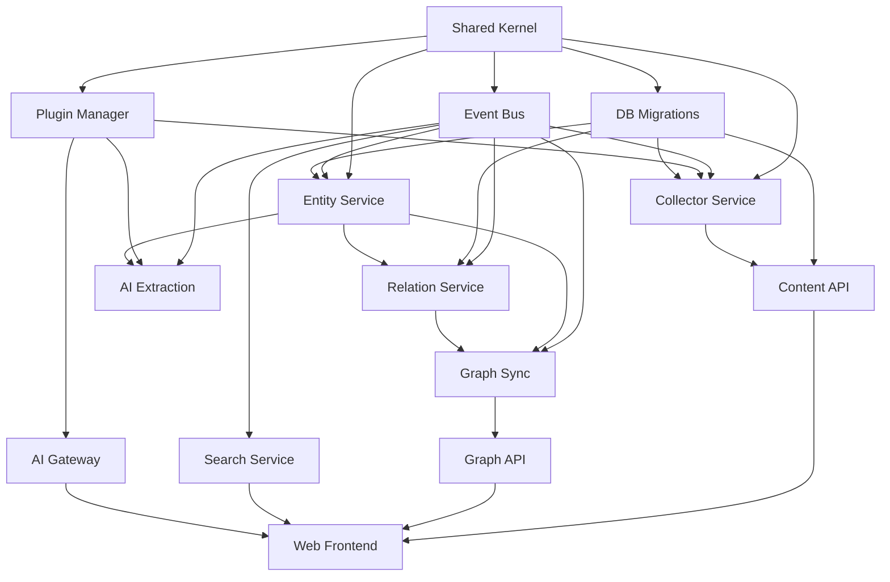

# Athena Knowledge Platform — Blueprint

> **施工蓝图 v1.0**
>
> 本文档是 Athena 项目从设计到实现的唯一权威总图。
> Blueprint 未完成或未更新时，禁止开始对应模块的业务代码开发。
>
> 批准日期: 2026-08-05
> 下次审查: Phase 1 启动前

---

## 目录

1. [系统身份](#1-系统身份)
2. [架构全景](#2-架构全景)
3. [组件目录](#3-组件目录)
4. [数据架构](#4-数据架构)
5. [施工顺序](#5-施工顺序)
6. [接口契约](#6-接口契约)
7. [技术栈](#7-技术栈)
8. [集成架构](#8-集成架构)
9. [部署架构](#9-部署架构)
10. [质量体系](#10-质量体系)
11. [风险管理](#11-风险管理)
12. [验收标准](#12-验收标准)

---

## 1. 系统身份

| 属性 | 值 |
|------|-----|
| 项目名称 | Athena Knowledge Platform |
| 项目类型 | AI 驱动的全球知识平台 |
| 许可协议 | Apache 2.0 |
| 设计寿命 | 10+ 年 |
| 架构风格 | Modular Monolith → Microservices (Phase 4+) |
| 开发阶段 | Phase 0 — Foundation (施工蓝图阶段) |
| 核心文档 | 38 个文件，覆盖 6 大领域 |

### 1.1 核心原则（不可违背）

1. **Documentation First** — 本文档先于所有代码
2. **Architecture First** — 接口和契约先于实现
3. **Domain First** — 代码组织围绕领域模型
4. **API First** — 所有功能以 API 契约定义
5. **Plugin First** — 核心最小化，业务能力插件化
6. **AI First** — AI 是架构原语，不是功能附加
7. **Test First** — TDD，先测试后实现
8. **Security First** — 零信任，默认不信任任何输入

---

## 2. 架构全景

### 2.1 系统分层

```
┌─────────────────────────────────────────────────────────────┐
│                      CLIENT LAYER                            │
│   Web App (Next.js)  │  Mobile App (TBD)  │  API Consumers  │
└──────────────────────────┬──────────────────────────────────┘
                           │ HTTPS / WSS
┌──────────────────────────┴──────────────────────────────────┐
│                    API GATEWAY LAYER                         │
│   Kong Gateway: Auth │ Rate Limit │ Routing │ Versioning    │
└──────────────────────────┬──────────────────────────────────┘
                           │
┌──────────────────────────┴──────────────────────────────────┐
│                   APPLICATION LAYER                          │
│                                                              │
│  ┌──────────┐ ┌──────────┐ ┌──────────┐ ┌──────────────┐  │
│  │ Content  │ │Knowledge │ │ Search   │ │ AI Service   │  │
│  │ Service  │ │ Service  │ │ Service  │ │              │  │
│  │          │ │          │ │          │ │ Model Router │  │
│  │Collector │ │ Entity   │ │ Fulltext │ │ Prompt Mgmt  │  │
│  │ Pipeline │ │ Relation │ │ Vector   │ │ Task Queue   │  │
│  │ Cleaner  │ │ Graph Q  │ │ Hybrid   │ │ Evaluation   │  │
│  └────┬─────┘ └────┬─────┘ └────┬─────┘ └──────┬───────┘  │
│       │            │            │               │          │
│  ┌────┴────────────┴────────────┴───────────────┴────────┐ │
│  │              SHARED KERNEL                             │ │
│  │  ID Types │ Value Objects │ Domain Events │ Enums     │ │
│  └────────────────────┬──────────────────────────────────┘ │
│                       │                                     │
│  ┌────────────────────┴──────────────────────────────────┐ │
│  │              PLUGIN MANAGER                            │ │
│  │  Load │ Register │ Configure │ Lifecycle │ Isolate     │ │
│  └───────────────────────────────────────────────────────┘ │
└──────────────────────────┬──────────────────────────────────┘
                           │
┌──────────────────────────┴──────────────────────────────────┐
│                  INFRASTRUCTURE LAYER                        │
│                                                              │
│  ┌──────────┐ ┌──────────┐ ┌──────────┐ ┌───────────────┐ │
│  │PostgreSQL│ │  Neo4j   │ │Elastic-  │ │    Redis      │ │
│  │ (Source  │ │ (Graph   │ │ search   │ │ (Cache/Queue) │ │
│  │ of Truth)│ │  Query)  │ │ (Search) │ │               │ │
│  └──────────┘ └──────────┘ └──────────┘ └───────────────┘ │
│                                                              │
│  ┌──────────┐ ┌───────────────────────────────────────────┐ │
│  │  MinIO   │ │        Message Bus (Redis Streams)        │ │
│  │ (Object  │ │  Events │ Commands │ Consumer Groups      │ │
│  │  Store)  │ └───────────────────────────────────────────┘ │
│  └──────────┘                                                │
└─────────────────────────────────────────────────────────────┘
```

### 2.2 核心数据流

```
                    ┌───────────┐
                    │  Sources  │ (RSS, API, Scraper)
                    └─────┬─────┘
                          │
                    ┌─────▼─────┐
                    │ Collector │ Fetch → Parse → Clean → Publish
                    └─────┬─────┘
                          │ ArticleFetched Event
          ┌───────────────┼───────────────┐
          │               │               │
    ┌─────▼─────┐  ┌──────▼──────┐  ┌────▼────┐
    │    AI     │  │  Knowledge  │  │ Search  │
    │ Summarize │  │  Extract    │  │  Index  │
    │ Translate │  │  Link       │  │         │
    └─────┬─────┘  └──────┬──────┘  └─────────┘
          │               │
          │         ┌─────▼─────┐
          │         │   Neo4j   │ (Graph Sync via Events)
          │         └───────────┘
          │
    ┌─────▼─────┐
    │  Article  │ (Update summary, entities)
    └───────────┘
```

---

## 3. 组件目录

### 3.1 组件清单

每个组件包含：**职责** / **依赖** / **接口** / **存储** / **验收标准**

---

#### C-01: Shared Kernel

| 属性 | 值 |
|------|-----|
| 阶段 | Phase 1 — Sprint 1 |
| 职责 | 提供所有模块共享的类型、值对象、基类 |
| 依赖 | 无 |
| 接口 | Python Package: `src/shared/domain/` |
| 输出 | `EntityId, Language, Confidence, Pagination, DomainEvent, AggregateRoot` |
| 文档 | [Shared Kernel](domain/shared-kernel.md) |
| 验收 | 所有枚举和值对象通过单元测试；mypy strict 通过 |

---

#### C-02: Event Bus

| 属性 | 值 |
|------|-----|
| 阶段 | Phase 1 — Sprint 1 |
| 职责 | 领域事件的发布/订阅基础设施 |
| 依赖 | C-01 Shared Kernel |
| 接口 | `IEventBus.publish(event)`, `IEventBus.subscribe(type, handler)` |
| 存储 | Redis Streams (Phase 1-2), `system_event_log` 表 (Outbox) |
| 文档 | [Event Model](domain/event-model.md), [RFC-002](rfc/RFC-002-message-queue.md) |
| 验收 | 事件发布成功率 ≥ 99.9%；消费者幂等；Outbox Worker 正常运行 |

---

#### C-03: Plugin Manager

| 属性 | 值 |
|------|-----|
| 阶段 | Phase 1 — Sprint 2 |
| 职责 | 插件注册、加载、生命周期管理、依赖注入 |
| 依赖 | C-01 Shared Kernel |
| 接口 | `IPlugin`, `ISourcePlugin`, `IProcessorPlugin`, `IStoragePlugin`, `IAIProviderPlugin` |
| 存储 | `system_plugin_registry` 表 |
| 文档 | [Plugin Specification](architecture/plugin-specification.md) |
| 验收 | 5 类插件接口均可注册和调用；插件异常不传播到核心；热加载（Phase 3+） |

---

#### C-04: Database Migrations

| 属性 | 值 |
|------|-----|
| 阶段 | Phase 1 — Sprint 1 |
| 职责 | PostgreSQL Schema 的版本化迁移 |
| 依赖 | C-01 |
| 接口 | Alembic CLI: `upgrade`, `downgrade`, `revision` |
| 存储 | PostgreSQL 16 + pgvector |
| 文档 | [ER Diagram](database/er-diagram.md) |
| 验收 | 13 张表全部创建；所有索引验证；迁移可正向/逆向执行 |

---

#### C-05: Collector Service

| 属性 | 值 |
|------|-----|
| 阶段 | Phase 1 — Sprint 3-4 |
| 职责 | 多源内容采集：Fetch → Parse → Clean → Dedup → Publish |
| 依赖 | C-01, C-02, C-03, C-04 |
| 接口 | `POST /v1/sources/{id}/fetch` (手动触发), 内部定时调度 |
| 存储 | `content_sources`, `content_articles`, `content_article_authors`, `content_article_categories` |
| 文档 | [Collector Service](architecture/collector-service.md) |
| 验收 | 支持 RSS/API/Scraper 三种源类型；URL Hash 去重 100% 准确；单源错误不影响其他源 |

---

#### C-06: Content API

| 属性 | 值 |
|------|-----|
| 阶段 | Phase 1 — Sprint 5 |
| 职责 | 文章和内容源的 RESTful CRUD API |
| 依赖 | C-04, C-05 |
| 接口 | `GET/POST /v1/sources`, `GET /v1/articles`, `GET /v1/articles/{id}` |
| 存储 | PostgreSQL (read from C-04 tables) |
| 文档 | [API Design](api/api-design.md), [OpenAPI](api/openapi.yaml) |
| 验收 | 所有端点响应 < 200ms P95；分页/筛选/排序正确；OpenAPI 与实际响应一致 |

---

#### C-07: Knowledge Entity Service

| 属性 | 值 |
|------|-----|
| 阶段 | Phase 2 — Sprint 1-2 |
| 职责 | 知识实体的 CRUD、多语言名称管理、属性管理 |
| 依赖 | C-01, C-02, C-04 |
| 接口 | `GET/POST /v1/entities`, `GET /v1/entities/{id}`, `PUT /v1/entities/{id}/merge` |
| 存储 | `knowledge_entities`, `knowledge_entity_names`, `knowledge_entity_aliases`, `knowledge_entity_properties` |
| 文档 | [DDD Detailed](domain/ddd-detailed.md), [Knowledge Model](domain/knowledge-model.md) |
| 验收 | 支持 8 种实体类型；多语言名称查询正确；实体合并后关系重定向 |

---

#### C-08: AI Extraction Pipeline

| 属性 | 值 |
|------|-----|
| 阶段 | Phase 2 — Sprint 3-4 |
| 职责 | 消费 ArticleFetched 事件 → 调用 AI 提取实体和关系 → 产出 Statement |
| 依赖 | C-02, C-03 (AI Plugin), C-07 |
| 接口 | 事件消费者（非 HTTP API）, 内部 `POST /v1/ai/extract/entities` 触发 |
| 存储 | `knowledge_statements` |
| 文档 | [Event Model](domain/event-model.md), [Agent Spec](architecture/agent-specification.md) |
| 验收 | 单篇文章提取 < 30s P95；实体召回率 ≥ 80%；Statement 可溯源到原文 |

---

#### C-09: Relation Service

| 属性 | 值 |
|------|-----|
| 阶段 | Phase 2 — Sprint 5 |
| 职责 | 知识关系的管理、查询、废弃 |
| 依赖 | C-02, C-04, C-07 |
| 接口 | `GET /v1/entities/{id}/relations`, `POST /v1/relations/{id}/deprecate` |
| 存储 | `knowledge_relations`, `knowledge_relation_statements` |
| 文档 | [DDD Detailed](domain/ddd-detailed.md) |
| 验收 | 关系查询 < 100ms P95；时间范围查询正确；冲突声明保留 |

---

#### C-10: Graph Sync Worker

| 属性 | 值 |
|------|-----|
| 阶段 | Phase 2 — Sprint 6 |
| 职责 | 消费 Entity/Relation 事件 → 同步到 Neo4j 图数据库 |
| 依赖 | C-02, C-07, C-09, Neo4j |
| 接口 | 事件消费者（非 HTTP API） |
| 存储 | Neo4j (Read-optimized Graph View) |
| 文档 | [Graph Model](domain/graph-model.md) |
| 验收 | PG → Neo4j 同步延迟 < 1s；图数据可从 Event Store 完整重放；路径查询正确 |

---

#### C-11: Graph API

| 属性 | 值 |
|------|-----|
| 阶段 | Phase 2 — Sprint 6 |
| 职责 | 知识图谱的遍历和查询 API |
| 依赖 | C-10, Neo4j |
| 接口 | `GET /v1/graph/entity/{id}/neighbors`, `GET /v1/graph/paths`, `GET /v1/graph/trending` |
| 存储 | Neo4j (Read-only) |
| 文档 | [Graph Model](domain/graph-model.md), [API Design](api/api-design.md) |
| 验收 | 邻居查询 < 50ms；2 度子图查询 < 200ms；路径查询 < 500ms (depth ≤ 3) |

---

#### C-12: Search Service

| 属性 | 值 |
|------|-----|
| 阶段 | Phase 2 — Sprint 7-8 |
| 职责 | 全文搜索、向量搜索、混合搜索 |
| 依赖 | C-02, Elasticsearch, pgvector |
| 接口 | `GET /v1/search`, `GET /v1/search/autocomplete` |
| 存储 | Elasticsearch (全文索引), pgvector (向量索引) |
| 文档 | [DDD Detailed](domain/ddd-detailed.md) — Search Context, [API Design](api/api-design.md) |
| 验收 | 搜索 < 100ms P50, < 500ms P99；混合搜索 RRF 融合正确；高亮/分面/建议正常 |

---

#### C-13: AI Model Gateway

| 属性 | 值 |
|------|-----|
| 阶段 | Phase 3 — Sprint 1-2 |
| 职责 | 多模型路由、负载均衡、降级切换、成本控制 |
| 依赖 | C-03 (AI Plugin) |
| 接口 | `POST /v1/ai/summarize`, `POST /v1/ai/translate`, `POST /v1/ai/chat` |
| 文档 | [DDD Detailed](domain/ddd-detailed.md) — AI Context, [API Design](api/api-design.md) |
| 验收 | 模型故障自动切换 < 5s；成本追踪准确；支持至少 3 个 Provider |

---

#### C-14: Web Frontend

| 属性 | 值 |
|------|-----|
| 阶段 | Phase 4 — Sprint 1-6 |
| 职责 | 用户界面：搜索、知识浏览、问答、个性化 |
| 依赖 | C-06, C-11, C-12, C-13 |
| 接口 | Next.js App Router, 消费 REST + GraphQL API |
| 技术栈 | Next.js (暂定，待 RFC-003) |
| 验收 | Lighthouse Performance ≥ 90；SEO 就绪；响应式设计 |

---

### 3.2 组件依赖图



---

## 4. 数据架构

### 4.1 存储引擎分工

```
┌─────────────────────────────────────────────────────┐
│                   PostgreSQL 16                      │
│  Source of Truth — 所有数据的权威来源                │
│                                                      │
│  Schema: content   → sources, articles, authors      │
│  Schema: knowledge → entities, relations, statements │
│  Schema: account   → users, preferences              │
│  Schema: system    → plugins, event_log              │
│                                                      │
│  Extensions: pgvector (vector index)                 │
└─────────────────────────────────────────────────────┘
          │                    │
          │ Domain Events      │ Domain Events
          ▼                    ▼
┌─────────────────┐  ┌─────────────────┐
│     Neo4j        │  │  Elasticsearch  │
│  Graph Query     │  │  Fulltext Index │
│                  │  │                 │
│  Nodes: Entity,  │  │  Indexes:       │
│    Article,      │  │  - articles     │
│    Topic         │  │  - entities     │
│  Edges: 20+      │  │  - statements   │
│    relation types│  │                 │
│                  │  │  Analyzers:     │
│  GDS: PageRank,  │  │  - cjk (中日韩) │
│    Louvain, etc. │  │  - standard (en)│
└─────────────────┘  └─────────────────┘

┌─────────────────┐  ┌─────────────────┐
│     Redis        │  │     MinIO       │
│  Cache + Queue   │  │  Object Store   │
│                  │  │                 │
│  - API Response  │  │  - Raw HTML     │
│  - Session       │  │  - Images       │
│  - Rate Limit    │  │  - Documents    │
│  - Event Streams │  │  - Backups      │
└─────────────────┘  └─────────────────┘
```

### 4.2 数据同步策略

```
PostgreSQL (Write) ──Event──▶ Redis Streams ──▶ Consumers
                                │
                    ┌───────────┼───────────┐
                    ▼           ▼           ▼
                Neo4j Sync  ES Indexer  Cache Warmer
```

- **一致性模型**: 最终一致性（Eventual Consistency）
- **同步延迟**: < 1s (正常), < 5s (P99)
- **失败处理**: Outbox Pattern + 重试 + Dead Letter
- **重建能力**: 所有读视图可从 PG + Event Store 完整重放

---

## 5. 施工顺序

### 5.1 Phase 0 — Foundation（当前）

**状态**: 90% 完成

**剩余工作**:
- [x] 项目宪法与治理体系
- [x] 完整文档体系（38 文件）
- [x] 架构设计（Knowledge Model / DDD / ER / Graph / Event / API）
- [x] 架构审查（ADR-002）
- [x] RFC-001（后端语言）✅ Python FastAPI
- [x] RFC-002（消息队列）✅ Redis Streams
- [ ] RFC-003（前端框架）— P1，Blueprint 完成后
- [ ] RFC-004（搜索引擎）— P1，Blueprint 完成后
- [ ] RFC-005（图数据库）— P1，Blueprint 完成后
- [ ] RFC-006（移动端）— P2，可延后
- [ ] **本 Blueprint 审批** ← 当前阻塞项

**禁止**: 任何业务代码

---

### 5.2 Phase 1 — Core Infrastructure（预计 6-8 周）

**准入条件**: Blueprint 审批通过 + 4 个未完成 RFC 中至少 2 个 P1 级完成

| Sprint | 组件 | 产出 |
|--------|------|------|
| 1 | C-01 Shared Kernel + C-04 DB Migrations | `src/shared/`, `alembic/`, 13 张表 |
| 2 | C-02 Event Bus + C-03 Plugin Manager | `IEventBus` 实现, Outbox Worker, Plugin Registry |
| 3 | C-05 Collector (RSS Source) | RSS 采集管道完整流程 |
| 4 | C-05 Collector (API + Scraper Sources) | 全部 3 种源类型 |
| 5 | C-06 Content API | 文章/源 CRUD API |
| 6 | Docker 化 + CI/CD 完善 | `docker-compose.yml`, CI 管道全绿 |

**禁止**: 业务功能代码、前端 UI

---

### 5.3 Phase 2 — Domain Core（预计 8-10 周）

| Sprint | 组件 | 产出 |
|--------|------|------|
| 1-2 | C-07 Entity Service | 实体 CRUD + 多语言 |
| 3-4 | C-08 AI Extraction | Statement 产出管道 |
| 5 | C-09 Relation Service | 关系管理 |
| 6 | C-10 Graph Sync + C-11 Graph API | Neo4j 图查询 |
| 7-8 | C-12 Search Service | 全文/向量/混合搜索 |

**准入条件**: Phase 1 全部完成

---

### 5.4 Phase 3 — AI Integration（预计 6-8 周）

| Sprint | 组件 | 产出 |
|--------|------|------|
| 1-2 | C-13 AI Model Gateway | 多模型路由 |
| 3-4 | RAG Pipeline | 知识问答管道 |
| 5-6 | AI Evaluation Framework | 评测框架 + 回归测试 |

---

### 5.5 Phase 4 — User Experience（预计 8-10 周）

| Sprint | 组件 | 产出 |
|--------|------|------|
| 1-4 | C-14 Web Frontend | 完整 Web 应用 |
| 5-6 | Personalization Engine | 推荐算法 |
| 7-8 | Mobile App (TBD) | Flutter/RN |

---

### 5.6 Phase 5 — Ecosystem（2028+）

- 插件市场
- 公开 API + SDK
- 第三方集成
- 社区治理

---

## 6. 接口契约

### 6.1 关键接口清单

| 接口 ID | 契约文件 | 提供者 | 消费者 |
|---------|---------|--------|--------|
| IF-01 | `IEventBus` | C-02 Event Bus | C-05, C-07, C-08, C-09, C-10, C-12 |
| IF-02 | `ISourcePlugin` | C-03 Plugin Manager | C-05 Collector |
| IF-03 | `IEntityRepository` | C-07 Entity Service | C-08 AI Extraction, C-09 Relation |
| IF-04 | `ISearchRepository` | C-12 Search Service | C-06 Content API, C-14 Frontend |
| IF-05 | REST API `/v1/*` | C-06, C-11, C-12, C-13 | C-14 Frontend, 3rd Party |
| IF-06 | GraphQL `/v1/graphql` | C-11 Graph API | C-14 Frontend |

### 6.2 接口变更控制

- 接口变更需更新对应的 ADR 或 RFC
- 主版本变更保留旧接口 ≥ 6 个月
- 所有接口在 OpenAPI 3.1 中定义
- 消费者升级有明确的迁移窗口

---

## 7. 技术栈

### 7.1 已决策

| 决策 | 方案 | 文档 |
|------|------|------|
| 后端语言 | Python 3.12 + FastAPI | RFC-001 |
| 消息队列 | Redis Streams (P1-2) → Kafka (P3+) | RFC-002 |
| 主数据库 | PostgreSQL 16 + pgvector | ER Diagram |
| 图数据库 | Neo4j 5 (暂定) | 待 RFC-005 |
| 搜索引擎 | Elasticsearch 8 (暂定) | 待 RFC-004 |
| 缓存 | Redis 7 | Architecture Overview |
| 对象存储 | MinIO (S3-compatible) | Architecture Overview |
| 包管理 Python | uv | Coding Standard |
| 包管理 Node.js | pnpm | Coding Standard |
| ORM | SQLAlchemy 2.0 (async) | Architecture Overview |
| 前端框架 | Next.js (暂定) | 待 RFC-003 |
| 容器化 | Docker + Docker Compose | Environment Setup |
| API 规范 | OpenAPI 3.1 | openapi.yaml |

### 7.2 待决策（RFC）

| 决策 | 优先级 | 候选方案 | 暂定倾向 |
|------|--------|----------|----------|
| 前端框架 | P1 | Next.js vs Remix | **Next.js** |
| 搜索引擎 | P1 | Elasticsearch vs Meilisearch | **Elasticsearch** |
| 图数据库 | P1 | Neo4j vs PostgreSQL AGE | **Neo4j** |
| 移动端 | P2 | Flutter vs React Native | 延后决策 |

---

## 8. 集成架构

### 8.1 关键集成场景

**场景 1: 内容采集 → 知识提取（核心链路）**

```
1. Collector Service 拉取 → ArticleFetched Event → Redis Streams
2. AI Extraction Worker 消费 → 调用 LLM → Statement
3. EntityService 消费 Statement → 创建/更新 Entity
4. Graph Sync Worker 消费 EntityChanged → 同步到 Neo4j
5. Search Indexer 消费 → 更新 Elasticsearch + pgvector
```

**场景 2: 用户搜索**

```
1. POST /v1/search?q=AI+protein&mode=hybrid
2. Search Service → Elasticsearch (fulltext) + pgvector (vector)
3. RRF 融合 → 返回结果 + facets + highlights
```

**场景 3: 知识问答**

```
1. POST /v1/ai/chat {question: "What is Apple''s CEO?"}
2. AI Gateway → Search Entities → Get Relations → Assemble Context
3. LLM Call (with Context) → Answer + Citations
```

### 8.2 集成测试场景

| ID | 场景 | 涉及组件 |
|----|------|----------|
| IT-01 | RSS 源 → 文章发布 → 搜索可查 | C-05, C-06, C-12 |
| IT-02 | 文章发布 → AI 提取实体 → 实体入库 | C-05, C-08, C-07 |
| IT-03 | 实体创建 → Neo4j 同步 → 图查询可见 | C-07, C-10, C-11 |
| IT-04 | 用户搜索 → 结果高亮 → 点击文章详情 | C-12, C-06 |

---

## 9. 部署架构

### 9.1 开发环境

```yaml
# docker-compose.yml
services:
  postgres:    # PostgreSQL 16 + pgvector
  redis:       # Redis 7
  elasticsearch: # Elasticsearch 8 (Phase 2+)
  neo4j:       # Neo4j 5 (Phase 2+)
  minio:       # MinIO (Phase 2+)
  api:         # FastAPI (hot reload, port 8000)
```

### 9.2 生产拓扑（Phase 4+）

```
┌───────────────┐     ┌───────────────┐
│  Region: Asia │     │  Region: EU   │
│  ┌─────────┐  │     │  ┌─────────┐  │
│  │FastAPI  │  │     │  │FastAPI  │  │
│  │Workers  │  │     │  │Workers  │  │
│  └────┬────┘  │     │  └────┬────┘  │
│       │       │     │       │       │
│  ┌────┴────┐  │     │  ┌────┴────┐  │
│  │   PG    │  │     │  │   PG    │  │
│  │ (Primary)│  │     │  │(Replica)│  │
│  └─────────┘  │     │  └─────────┘  │
└───────────────┘     └───────────────┘
         │                      │
         └──────────┬───────────┘
                    │
          ┌─────────┴─────────┐
          │   Global DNS LB   │
          │   (Geo-routing)   │
          └───────────────────┘
```

---

## 10. 质量体系

### 10.1 质量门禁（每个 PR）

| # | 门禁 | 工具 |
|---|------|------|
| 1 | Lint | ruff (Python), eslint (TS) |
| 2 | 类型检查 | mypy --strict, tsc --noEmit |
| 3 | 单元测试 | pytest, vitest |
| 4 | 覆盖率不下降 | pytest-cov, codecov |
| 5 | 安全扫描 | Trivy, Gitleaks |
| 6 | 文档更新 | 手动检查 + CI 文档存在性检查 |
| 7 | 1 人 Approve | GitHub PR Review |

### 10.2 测试覆盖率目标

| 层级 | Phase 1 | Phase 2 | Phase 3+ |
|------|---------|---------|----------|
| 核心域 | 90% | 90% | 90% |
| 应用层 | 80% | 80% | 85% |
| 基础设施 | 70% | 70% | 75% |

---

## 11. 风险管理

### 11.1 高风险项

| ID | 风险 | 触发条件 | 缓解 | 责任人 |
|----|------|----------|------|--------|
| R1 | EAV 性能退化 | entities > 1M | 物化视图, JSONB 冗余 | Backend |
| R2 | PG-Neo4j 同步断裂 | Neo4j 宕机 > 5min | Outbox + 重试 + 告警 | Infra |
| R3 | AI 提取质量低 | 新模型上线 | Statement 审核 + 质量评分 | AI |

### 11.2 技术债务登记

| 债务 | 登记日 | 偿还期限 |
|------|--------|----------|
| Monolith → Microservices 拆分策略 | 2026-08-03 | Phase 4 前 |
| AI Model Router fallback 策略 | 2026-08-03 | Phase 3 前 |
| ReBAC 知识图谱访问控制 | 2026-08-03 | Phase 3 前 |

---

## 12. 验收标准

### 12.1 Phase 1 验收

- [ ] `src/shared/` 所有类型通过类型检查
- [ ] 13 张表在 PostgreSQL 中创建并可通过 Alembic 迁移
- [ ] 事件总线可发布/订阅，Outbox Worker 正常运行
- [ ] RSS Source 可成功采集 TechCrunch 并入库
- [ ] Content API 响应 < 200ms P95
- [ ] 所有组件有对应的集成测试

### 12.2 Phase 2 验收

- [ ] 100 个实体可正确创建、查询、合并
- [ ] AI 提取管道每小时可处理 ≥ 100 篇文章
- [ ] Neo4j 图查询路径（depth ≤ 3）< 500ms
- [ ] 搜索响应 < 100ms P50

### 12.3 Phase 3 验收

- [ ] 模型故障自动切换 < 5s
- [ ] RAG 问答准确率 ≥ 80%（人工评测）
- [ ] AI 成本在预算内

### 12.4 Phase 4 验收

- [ ] Lighthouse ≥ 90
- [ ] 首页加载 < 2s P95
- [ ] SEO 索引就绪

---

## 附录 A: 文档索引

完整文档列表见 [docs/README.md](docs/README.md)。

| 关键文档 | 路径 |
|----------|------|
| 项目宪法 | [docs/governance/constitution.md](governance/constitution.md) |
| 架构总览 | [docs/architecture/overview.md](architecture/overview.md) |
| DDD 详细 | [docs/domain/ddd-detailed.md](domain/ddd-detailed.md) |
| 知识模型 | [docs/domain/knowledge-model.md](domain/knowledge-model.md) |
| ER 图 | [docs/database/er-diagram.md](database/er-diagram.md) |
| API 设计 | [docs/api/api-design.md](api/api-design.md) |
| OpenAPI | [docs/api/openapi.yaml](api/openapi.yaml) |
| Collector | [docs/architecture/collector-service.md](architecture/collector-service.md) |
| 架构审查 | [docs/architecture/review-2026-08-03.md](architecture/review-2026-08-03.md) |
| 路线图 | [docs/product/roadmap.md](product/roadmap.md) |

---

## 附录 B: 修订历史

| 日期 | 版本 | 变更 |
|------|------|------|
| 2026-08-05 | v1.0 | 初始 Blueprint 发布 |

---

*本 Blueprint 是 Athena 项目的施工总图。任何偏离 Blueprint 的实现需要先更新 Blueprint 并走 ADR 审批。*
