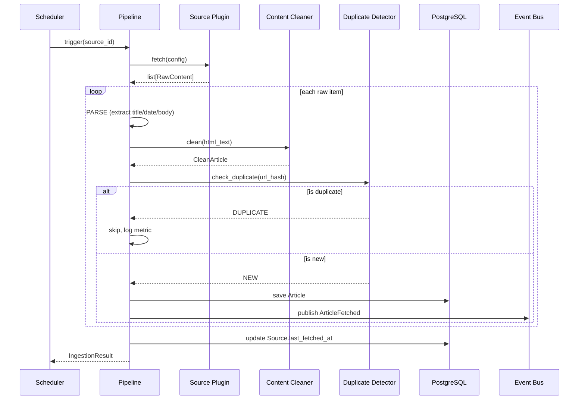

# Collector Service Architecture v1.0

## 概述

Collector Service（内容采集服务）是 Athena 内容管道的入口。负责从多源异构数据源拉取原始内容，
经过标准化和清洗后产出可供下游消费的 Article 实体。

---

## 1. 服务定位

```
┌──────────────────────────────────────────────────────────┐
│                     Collector Service                     │
│                                                           │
│  Source → Fetch → Normalize → Deduplicate → Publish      │
│                                                           │
│  输入: Source Plugin 配置                                  │
│  输出: ArticleFetched Domain Event                        │
│  依赖: Source Plugins (外部), ContentCleaningService      │
│  下游: Knowledge Context, AI Context, Search Context      │
└──────────────────────────────────────────────────────────┘
```

Collector Service 是 Content Context 的应用服务层实现，
不直接暴露 HTTP API。其触发方式：

- **定时调度**: Cron Scheduler 按 Source 的 `fetch_interval_seconds` 定期触发
- **手动触发**: `POST /v1/sources/{id}/fetch` 立即拉取
- **事件触发**: Webhook Source 被动接收推送

---

## 2. 核心管道（Pipeline）

### 2.1 管道阶段

```
                   ┌──────────────┐
                   │  1. FETCH    │  从 Source Plugin 获取原始数据
                   │  原始内容    │  RawContent {html, text, metadata}
                   └──────┬───────┘
                          │
                   ┌──────▼───────┐
                   │  2. PARSE    │  格式解析 + 元数据提取
                   │  结构化      │  ParsedArticle {title, author, date, body}
                   └──────┬───────┘
                          │
                   ┌──────▼───────┐
                   │  3. CLEAN    │  文本清洗
                   │  干净文本    │  CleanArticle {clean_text, language}
                   └──────┬───────┘
                          │
                   ┌──────▼───────┐
                   │  4. ENRICH   │  AI 增强（可选，异步）
                   │  增强内容    │  summary, entities_preview
                   └──────┬───────┘
                          │
                   ┌──────▼───────┐
                   │  5. DEDUP    │  去重检测
                   │  唯一内容    │  is_duplicate, similarity_score
                   └──────┬───────┘
                          │
                   ┌──────▼───────┐
                   │  6. PUBLISH  │  持久化 + 发布事件
                   │  已发布      │  ArticlePublished Event
                   └──────────────┘
```

### 2.2 阶段详解

#### Stage 1: FETCH

```python
class FetchStage:
    """从 Source Plugin 拉取原始内容"""
    
    async def execute(self, source: Source) -> list[RawContent]:
        plugin = self.plugin_registry.get(source.source_type)
        
        raw_items = await plugin.fetch(source.fetch_config)
        
        # 限制单次拉取数量
        return raw_items[:source.max_items_per_fetch]
```

**输入**: Source 配置（URL、认证、超时、User-Agent）
**输出**: `list[RawContent]`

**每种 Source Type 的 Fetch 策略**:

| Source Type | 拉取策略 | 增量机制 |
|-------------|---------|----------|
| RSS | HTTP GET feed XML → 解析条目 | `ETag` / `Last-Modified` Header |
| API | HTTP GET/POST → JSON | `since` / `updated_after` 参数 |
| Scraper | Headless Browser → DOM 提取 | 对比已抓取的 URL 列表 |
| Manual | 用户直接提交内容 | N/A |

#### Stage 2: PARSE

```python
class ParseStage:
    """将原始内容解析为结构化 Article 数据"""
    
    async def execute(self, raw: RawContent) -> ParsedArticle:
        return ParsedArticle(
            title=self._extract_title(raw),
            authors=self._extract_authors(raw),
            published_at=self._extract_date(raw),
            content_html=self._extract_body(raw),
            content_text=strip_html(raw.html),
            language=None,  # Stage 3 检测
            images=self._extract_images(raw),
            source_metadata=raw.metadata,
        )
```

**需要处理的格式**:
- RSS/Atom XML → `feedparser` 解析
- JSON API → Schema 映射（每个 API Source 有独立的 Schema Mapping）
- HTML → `readability` / `trafilatura` 提取正文
- PDF → `pypdf` / `pdfplumber` 提取文本

#### Stage 3: CLEAN

```python
class CleanStage:
    """文本清洗、标准化、语言检测"""
    
    async def execute(self, parsed: ParsedArticle) -> CleanArticle:
        # 1. HTML 标签清理
        clean_text = self._strip_html(parsed.content_html)
        
        # 2. 空白符标准化
        clean_text = self._normalize_whitespace(clean_text)
        
        # 3. 广告/导航/页脚移除
        clean_text = self._remove_boilerplate(clean_text)
        
        # 4. 语言检测
        language = self._detect_language(clean_text)
        
        # 5. 质量检查
        if len(clean_text) < 100:
            raise ContentTooShortError(parsed.url)
        
        return CleanArticle(
            title=parsed.title,
            content_clean=clean_text,
            language=language,
            word_count=len(clean_text.split()),
            reading_time=len(clean_text.split()) // 200,
        )
```

**语言检测策略**:
1. HTTP Header `Content-Language`（优先信任）
2. Source 配置的默认语言
3. `fasttext` / `langdetect` 自动检测
4. 短文本（< 50 词）标记为 `unknown`，不强制检测

#### Stage 4: ENRICH（可选，异步解耦）

```python
class EnrichStage:
    """AI 增强——发布 ArticleFetched 事件后异步执行"""
    
    async def execute(self, clean: CleanArticle) -> EnrichedArticle:
        # 不在管道内阻塞执行
        # 而是发布 ArticleFetched 事件
        # 由 AI Context 异步消费后更新 Article
        return EnrichedArticle(
            **clean.__dict__,
            summary=None,        # AI 异步填充
            entities_preview=[], # AI 异步填充
        )
```

**设计决策**: ENRICH 阶段在管道中不执行 AI 调用，仅发布事件。
原因：
- AI 调用延迟高（10-30s），阻塞管道不合理
- AI 失败不影响内容入库（降级：无摘要但仍可搜索）
- 事件驱动解耦，AI Context 独立扩容

#### Stage 5: DEDUP

```python
class DedupStage:
    """重复检测"""
    
    async def execute(self, article: Article) -> DedupResult:
        # 1. 精确去重: URL Hash
        url_hash = sha256(article.url)
        existing = await self.repo.find_by_url_hash(url_hash)
        if existing:
            return DedupResult(is_duplicate=True, duplicate_of=existing.id, method="url_hash")
        
        # 2. 标题相似度去重（可选，Phase 3+）
        # similar = await self.vector_search.find_similar_title(article.title)
        
        return DedupResult(is_duplicate=False)
```

**去重策略分阶段实施**:

| Phase | 方法 | 准确率 | 性能 |
|-------|------|--------|------|
| Phase 1 | URL Hash (SHA-256) | 100% | O(1) Index Lookup |
| Phase 2 | Title Similarity (Jaccard) | ~90% | O(n) Simplified |
| Phase 3 | Content Similarity (MinHash / SimHash) | ~95% | O(log n) |
| Phase 4 | Semantic Similarity (Vector) | ~98% | O(log n) ANN |

#### Stage 6: PUBLISH

```python
class PublishStage:
    """持久化 Article 并发布领域事件"""
    
    async def execute(self, article: Article) -> ArticleId:
        # 1. 保存到 PostgreSQL
        article_id = await self.article_repo.save(article)
        
        # 2. 发布领域事件
        await self.event_bus.publish(ArticleFetched(
            article_id=article_id,
            source_id=article.source_id,
            url=str(article.url),
            url_hash=article.url_hash,
            title=article.title,
            language=article.language.code,
            published_at=article.published_at,
            content_type=article.content_type,
            word_count=article.word_count,
        ))
        
        # 3. 更新 Source 统计
        await self.source_repo.increment_article_count(article.source_id)
        
        return article_id
```

---

## 3. 错误处理与重试

### 3.1 错误分类

```python
class FetchError(Exception): ...
class ParseError(FetchError): ...       # 格式解析失败——重试无意义，跳过
class NetworkError(FetchError): ...     # 网络错误——可重试
class RateLimitError(FetchError): ...   # 被限流——退避后重试
class AuthError(FetchError): ...        # 认证失败——告警，不重试
class ContentTooShortError(Exception): ... # 内容过短——跳过
```

### 3.2 重试策略

```python
class RetryPolicy:
    max_retries: int = 3
    backoff_base: float = 1.0       # 指数退避基数（秒）
    backoff_multiplier: float = 2.0
    
    retryable_errors = [NetworkError, RateLimitError]
    non_retryable_errors = [ParseError, AuthError]
    
    def should_retry(self, error: Exception, attempt: int) -> bool:
        if type(error) not in self.retryable_errors:
            return False
        if attempt >= self.max_retries:
            return False
        return True
    
    def delay_for(self, attempt: int) -> float:
        return self.backoff_base * (self.backoff_multiplier ** attempt)
```

### 3.3 Source 健康管理

```
连续 3 次 NetworkError → Source status = "degraded"
连续 10 次任何错误    → Source status = "error"
连续 24h 无错误        → Source status = "active" (自动恢复)
AuthError              → Source status = "error" + 告警通知
```

---

## 4. 并发与调度

### 4.1 调度器设计

```python
class CollectorScheduler:
    """基于 APScheduler 的定时调度器"""
    
    def __init__(self):
        self.scheduler = AsyncIOScheduler()
    
    async def start(self):
        sources = await self.source_repo.find_active()
        for source in sources:
            self.scheduler.add_job(
                func=self.collect_source,
                trigger="interval",
                seconds=source.fetch_config.interval_seconds,
                args=[source.id],
                id=f"collect_{source.id}",
                max_instances=1,  # 同一 Source 不并发
            )
    
    async def collect_source(self, source_id: SourceId):
        source = await self.source_repo.find_by_id(source_id)
        pipeline = CollectorPipeline(source)
        await pipeline.run()
```

### 4.2 并发控制

```
全局并发: 最多 N 个 Source 同时抓取（默认 10）
单源并发: 每个 Source 最多 1 个 Fetch 实例
全局速率: 每秒总请求数不超过 RateLimiter 上限
```

### 4.3 礼貌性策略（Politeness）

```python
class PolitenessPolicy:
    # 全局
    global_rate_limit: int = 50         # 全局每秒最大请求数
    global_concurrency: int = 10        # 全局最大并发 Source 数
    
    # 单源
    per_source_rate_limit: int = 5      # 单源每秒最大请求数
    respect_robots_txt: bool = True     # 遵守 robots.txt
    respect_crawl_delay: bool = True    # 遵守 Crawl-Delay 指令
    user_agent: str = "Athena/1.0 (+https://athena.ai/bot)"
```

---

## 5. 数据流图



---

## 6. 监控与可观测性

### 6.1 关键指标

| 指标 | 类型 | 说明 |
|------|------|------|
| `collector.articles_fetched_total` | Counter | 总抓取文章数 |
| `collector.articles_published_total` | Counter | 成功发布数 |
| `collector.articles_duplicate_total` | Counter | 去重拦截数 |
| `collector.fetch_errors_total` | Counter | 抓取错误数（按 error_type） |
| `collector.pipeline_duration_seconds` | Histogram | 管道总耗时 |
| `collector.stage_duration_seconds` | Histogram | 每阶段耗时（按 stage） |
| `collector.source_health` | Gauge | 各 Source 健康状态 |

### 6.2 告警规则

| 条件 | 级别 | 动作 |
|------|------|------|
| 单源连续失败 > 10 次 | Warning | 自动暂停 Source + 通知 |
| 全局去重率 > 80% | Warning | 可能存在 Source 配置重复 |
| 管道 P99 延迟 > 30s | Warning | 可能存在性能瓶颈 |
| 全局错误率 > 20% | Critical | 立即告警 |

---

## 7. 配置示例

```yaml
# Source 配置（存储在 content_sources 表）
sources:
  - name: "TechCrunch RSS"
    type: rss
    url: "https://techcrunch.com/feed/"
    language: en
    fetch_config:
      interval_seconds: 600
      timeout_seconds: 30
      max_items_per_fetch: 50
      headers:
        User-Agent: "Athena/1.0"
        Accept: "application/rss+xml, application/xml"

  - name: "arXiv CS.AI"
    type: api
    url: "http://export.arxiv.org/api/query"
    language: en
    fetch_config:
      interval_seconds: 3600
      timeout_seconds: 60
      max_items_per_fetch: 100
      params:
        search_query: "cat:cs.AI"
        start: 0
        max_results: 100
        sortBy: "submittedDate"
        sortOrder: "descending"

  - name: "Custom News Site"
    type: scraper
    url: "https://example-news.com/latest"
    language: zh
    fetch_config:
      interval_seconds: 1800
      timeout_seconds: 45
      max_items_per_fetch: 20
      scraper_config:
        article_selector: "article.news-item"
        title_selector: "h2.title"
        body_selector: "div.content"
        date_selector: "time.published"
```

---

## 8. 扩展点

### 8.1 新增 Source Type

```python
# 1. 实现 ISourcePlugin 接口
class RedditSourcePlugin(ISourcePlugin):
    source_type = SourceType.API
    content_types = [ContentType.SOCIAL_POST]
    
    async def fetch(self, config: SourceConfig) -> AsyncIterator[RawContent]:
        ...

# 2. 注册插件
plugin_registry.register(RedditSourcePlugin())

# 3. 创建 Source 配置（通过 API 或管理后台）
POST /v1/sources
{
    "name": "r/MachineLearning",
    "source_type": "api",
    "url": "https://www.reddit.com/r/MachineLearning/hot.json",
    ...
}
```

### 8.2 自定义清洗规则

```python
# Processor Plugin 扩展清洗管道
class ChineseTextCleanerPlugin(IProcessorPlugin):
    stage = PipelineStage.CLEAN
    priority = 50  # 在通用清洗之后执行
    
    async def process(self, content: Content) -> Content:
        if content.language == Language("zh"):
            content.content_clean = self._normalize_cjk_punctuation(content.content_clean)
            content.content_clean = self._convert_fullwidth_numbers(content.content_clean)
        return content
```

---

*Collector Service 设计对应 Phase 1 交付物中的"内容源接入框架"。实现时需遵循 [Plugin Specification](plugin-specification.md) 的 Source Plugin 接口。*
