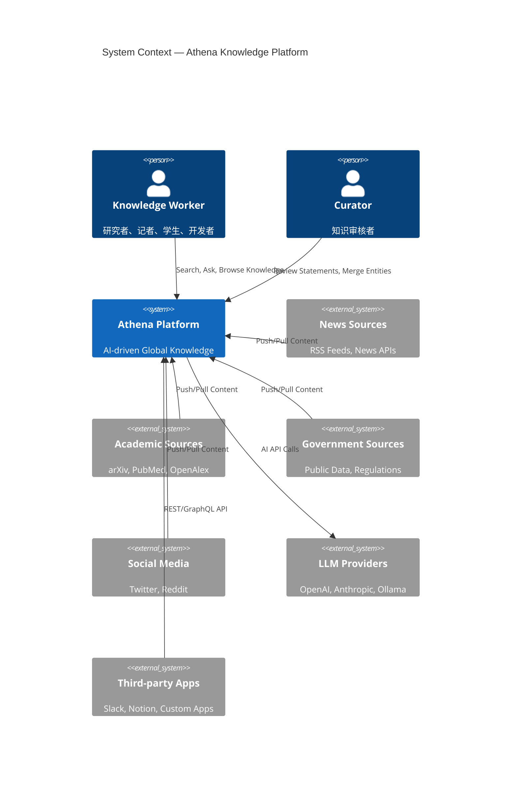
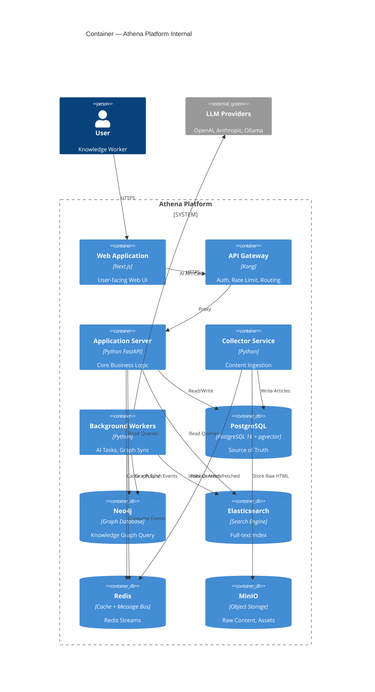
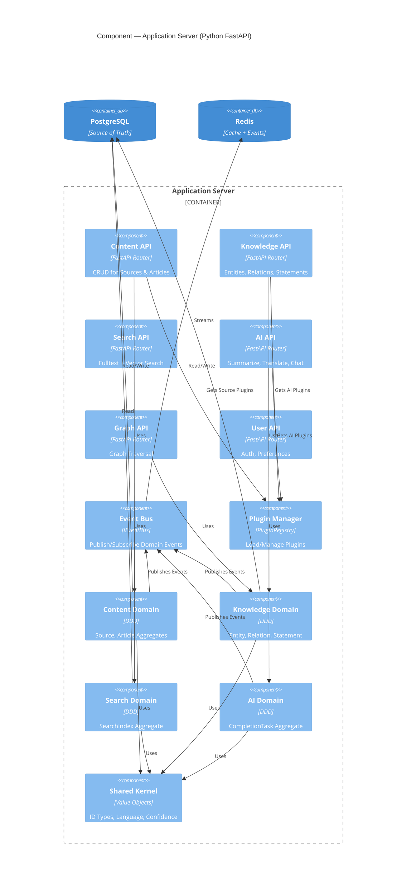

# C4 Architecture Diagrams

> Athena Knowledge Platform — C4 Model
> Level 1-3: System Context → Container → Component

---

## 1. System Context（系统上下文）

Athena 在全球知识生态系统中的位置。

**解释**: Athena 处于内容源（上游）和知识消费者（下游）之间。外部系统分为三类：内容提供者（新闻、学术、政府、社交）、AI 服务提供者（LLM）、和消费者（终端用户 + 第三方应用）。Athena 不直接面向大众消费者——第三方应用是主要的规模化分发渠道。

---

## 2. Container Diagram（容器图）

Athena 内部的主要容器和它们之间的交互。

**解释**: 核心容器分为三层：前端入口（Web → API Gateway）、业务处理（Application Server + Collector + Workers）、数据存储（PG + Neo4j + ES + Redis + MinIO）。数据写入只走 PostgreSQL（Source of Truth），Neo4j 和 ES 通过 Workers 消费事件异步同步。

---

## 3. Component Diagram（组件图）

Application Server 内部的组件分解。

**解释**: Application Server 按 Bounded Context 组织为 6 个 API 模块 + 4 个领域模块。Shared Kernel 被所有领域模块依赖。Event Bus 是唯一的跨模块通信通道。Plugin Manager 为 API 层提供插件实例。所有写入走 PostgreSQL，事件通过 Redis Streams 发布。

---

*C4 Model (Level 1-3) — 完整架构层级。Level 4 (Code) 在 Phase 1 实现时补充。*
