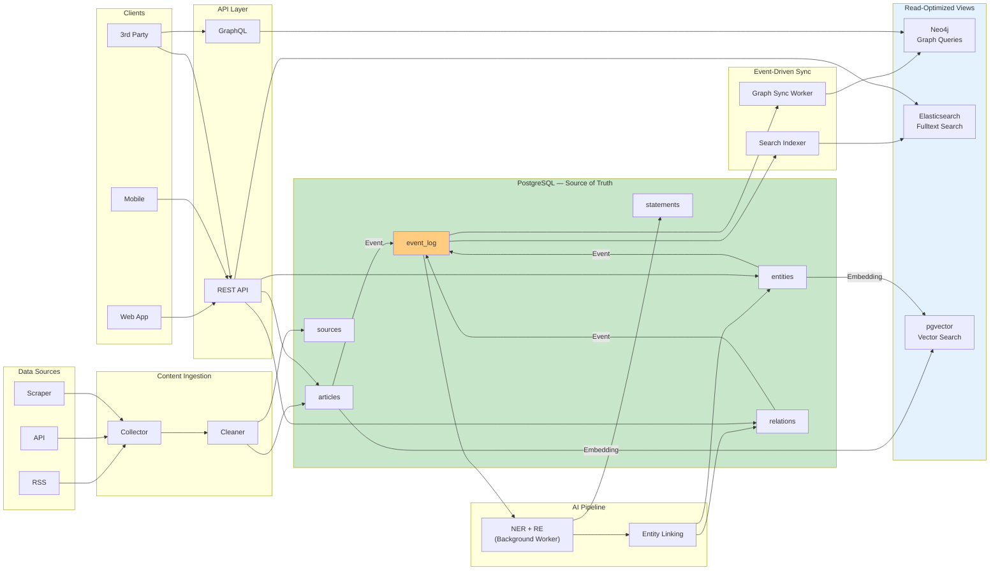
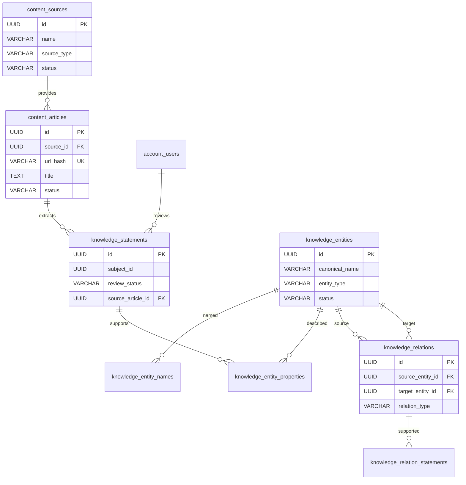
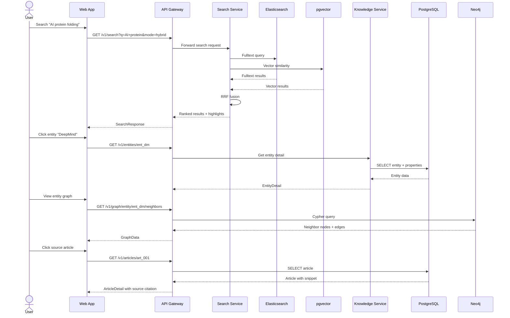

# Data Flow & Sequence Diagrams

---

## 10. Data Flow（数据流全景）

**解释**: 数据从左到右流动。所有写入集中在 PostgreSQL（绿色），通过 `event_log` 表（橙色）触发异步处理。AI Pipeline 和 Sync Workers 消费事件。读优化视图（蓝色）由事件驱动更新。API 层统一对外暴露。REST 用于 CRUD + 搜索，GraphQL 用于灵活图查询。

---

## 11. Database ER Diagram（参考）

完整 PostgreSQL ER 图见: [docs/database/er-diagram.md](../../database/er-diagram.md)

核心表关系速览：

**解释**: 4 个 Schema（content, knowledge, account, system）共 13 张表。核心链路：`sources → articles → statements → entity_properties + relations`。每张表包含标准字段（id, created_at, updated_at, deleted_at, version）。

---

## 12. Sequence Diagram（关键流程时序）

**场景: 用户搜索并查看知识**

**解释**: 单一搜索会话涉及 5 个数据存储的协同。搜索阶段使用 ES + pgvector 的混合检索 + RRF 融合。实体详情走 PG。图查询走 Neo4j。溯源点击回到 PG 的 articles 表。全程用户感知到的延迟由最慢的环节决定（向量搜索 ~50ms + ES ~30ms + RRF ~5ms ≈ < 100ms P50）。
