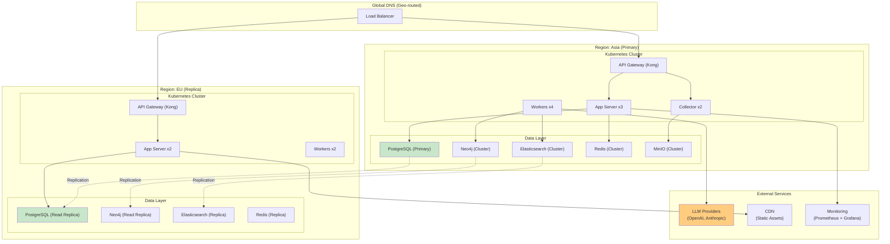
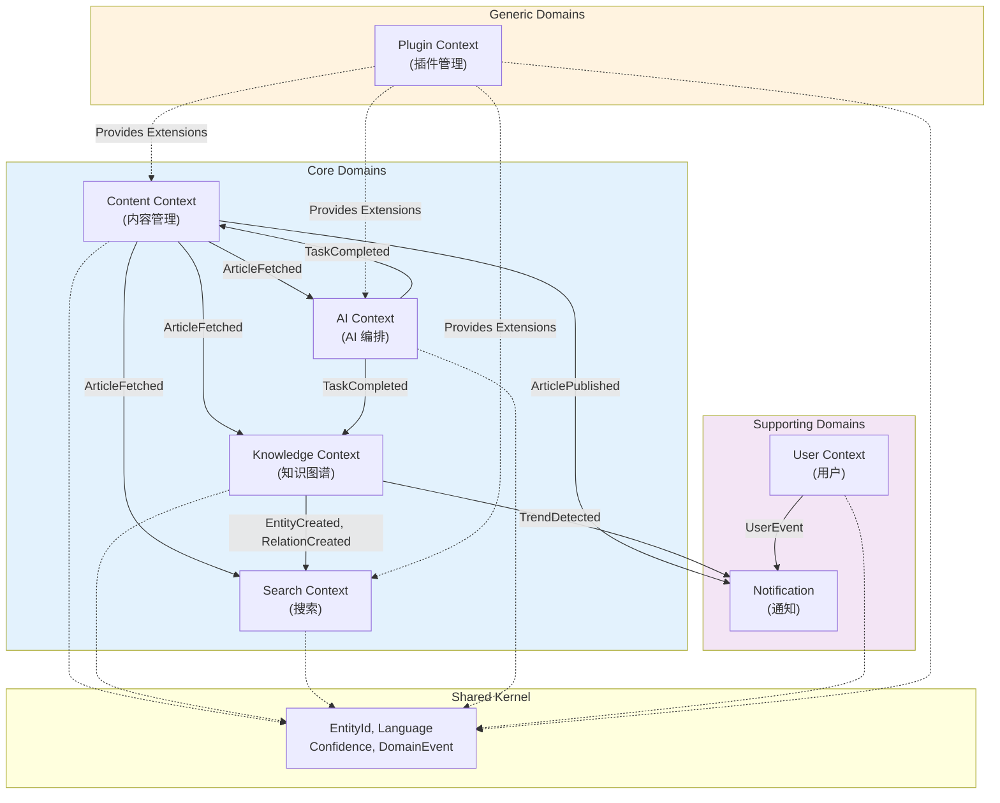

# Deployment & Infrastructure Diagrams

---

## 6. Deployment Diagram（部署拓扑）

**解释**: Phase 4+ 的生产拓扑。双区域部署（Asia Primary + EU Replica），数据层主从复制。Kubernetes 管理容器化服务。LLM 调用从 Worker 层发起（不经过 API Gateway）。监控系统独立部署。Phase 1-3 的 Modular Monolith 使用单区域 Docker Compose，此图为 Phase 4+ 目标态。

---

## 7. Domain Diagram（限界上下文关系）

**解释**: 六个 Bounded Context 分为三层：Core（Content/Knowledge/Search/AI）是业务核心，Supporting（User/Notification）辅助核心业务，Generic（Plugin）提供横向能力。实线箭头 = 领域事件流（异步解耦）。虚线 = 依赖 Shared Kernel。跨 Core 上下文只有事件通信，无直接 API 调用。
