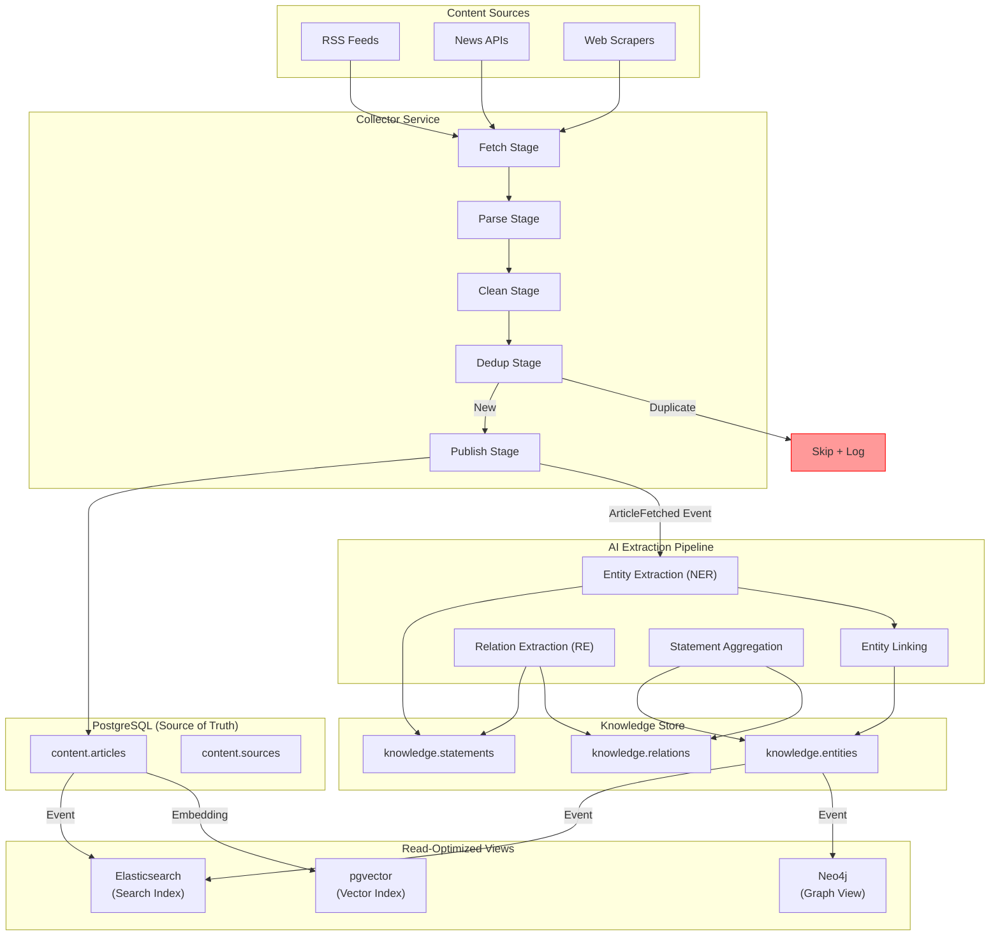
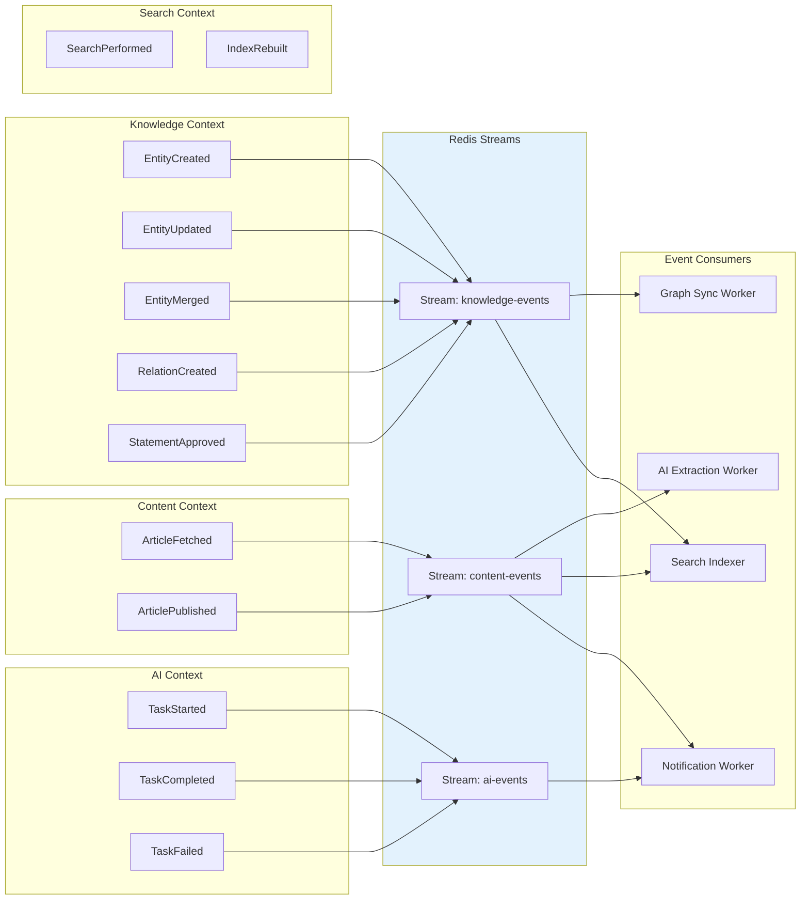

# Pipeline Diagrams

> Knowledge Pipeline + Event Pipeline

---

## 4. Knowledge Pipeline（知识管道）

从原始内容到结构化知识的端到端流程。

**解释**: 内容从 Source 进入 Collector 的五段管道（Fetch→Parse→Clean→Dedup→Publish）。重复内容被拦截（去重率目标 ≥ 80%）。发布后触发 ArticleFetched 事件，启动 AI 管道（NER→Linking→RE→Aggregation）。知识写入 PG 后，通过事件同步到三个读优化视图（ES/Neo4j/pgvector）。

---

## 5. Event Pipeline（事件管道）

领域事件在限界上下文之间的流动。

**解释**: 事件按上下文分组发布到独立的 Redis Stream。消费者按需订阅：AI Extraction Worker 消费 Content 事件触发实体提取；Graph Sync Worker 消费 Knowledge 事件同步 Neo4j；Search Indexer 消费 Content + Knowledge 事件更新 ES；Notification Worker 消费多类事件推送通知。Outbox Pattern 保证 PG 写入与事件发布的原子性。
