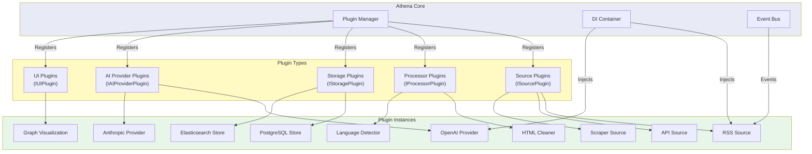
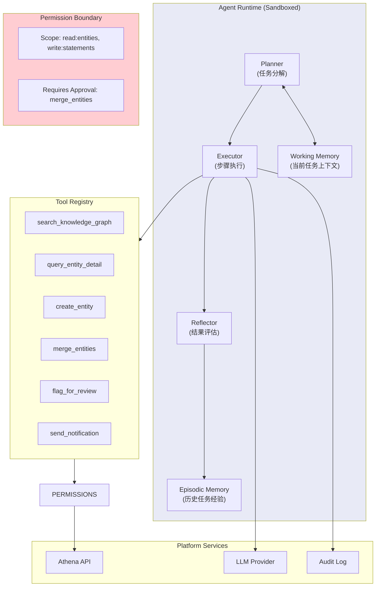

# Plugin & Agent Architecture

---

## 8. Plugin Architecture（插件架构）

**解释**: 五类插件接口定义了扩展契约。Plugin Manager 负责注册和生命周期。DI Container 注入依赖（如 HttpClient 注入 RSS Source Plugin）。Event Bus 用于插件间通信。具体实现（RSS Source、OpenAI Provider 等）是接口的实例。新能力只需实现对应接口 + 注册。

---

## 9. Agent Architecture（Agent 运行时）

**解释**: Agent 在沙箱中运行（Docker 容器，CPU/Mem/Timeout 限制）。Planner 分解目标→Executor 调用工具→Reflector 评估结果，循环直到完成。Working Memory 保存当前任务状态，Episodic Memory 保存历史经验（"上次处理类似文章时..."）。所有工具调用经过权限检查（Scope + Approval）。全部操作写入审计日志。
