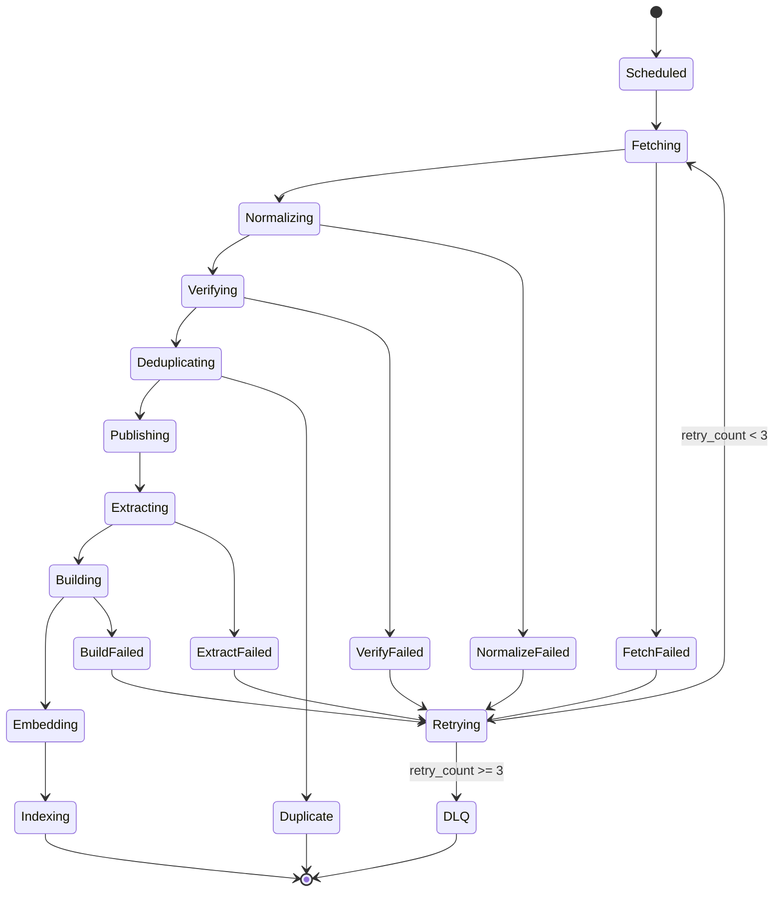

# Workflow Engine Specification

> Athena 知识管道的完整工作流引擎设计。
> 定义了从内容采集到知识发布的全部处理阶段、状态机、错误恢复和审计。
> 版本：v1.0 | 2026-08-06

---

## 1. 概述

Workflow Engine 是 Athena 的核心编排层。它不是一个集中式的 BPM 引擎，而是由 **Scheduler + Pipeline Stages + Event Bus + Workers** 组成的分布式管道。每个阶段是一个独立的处理节点，通过事件和消息队列连接。

### 设计原则

1. **管道化（Pipelined）**: 每个阶段独立处理，阶段间通过消息传递解耦
2. **可恢复（Recoverable）**: 每个阶段支持重试和死信队列
3. **可观测（Observable）**: 每个阶段输出 Metrics + Audit Log
4. **可扩展（Extensible）**: 通过 Plugin Hook 插入自定义处理逻辑

---

## 2. 管道总览

```
Scheduler
    │
    ▼
┌──────────┐    ┌──────────┐    ┌──────────┐    ┌──────────┐
│ Collector│───▶│Normalizer│───▶│ Verifier │───▶│Dedupli-  │
│          │    │          │    │          │    │  cator   │
└──────────┘    └──────────┘    └──────────┘    └─────┬────┘
                                                       │
                                              ┌────────┴────────┐
                                              │   Article       │
                                              │   Published     │
                                              └────────┬────────┘
                                                       │
                              ┌────────────────────────┼────────────────────────┐
                              │                        │                        │
                        ┌─────▼─────┐          ┌──────▼──────┐          ┌──────▼──────┐
                        │  Entity   │          │  Embedding  │          │   Event     │
                        │ Extractor │          │  Generator  │          │  Builder    │
                        └─────┬─────┘          └──────┬──────┘          └──────┬──────┘
                              │                       │                        │
                        ┌─────▼─────┐          ┌──────▼──────┐          ┌──────▼──────┐
                        │ Knowledge │          │   Vector    │          │  Relation   │
                        │  Builder  │          │   Indexer   │          │  Builder    │
                        └─────┬─────┘          └─────────────┘          └──────┬──────┘
                              │                                                 │
                        ┌─────▼─────┐                                    ┌──────▼──────┐
                        │   Graph   │                                    │   Search    │
                        │  Builder  │                                    │   Indexer   │
                        └─────┬─────┘                                    └─────────────┘
                              │
                        ┌─────▼─────┐
                        │ Publisher │
                        └───────────┘
```

---

## 3. 阶段详解

### 3.1 Scheduler（调度器）

**职责**: 定时触发内容采集。按 Source 的 `fetch_interval_seconds` 创建采集任务。

**关键行为**:
- 周期性扫描 `content_sources WHERE status='active'`
- 为每个到期 Source 创建 `FetchTask`
- 限制并发数（全局 ≤ 10 个 Source 同时抓取）

**Plugin Hook**: `on_schedule(source)` — 自定义调度逻辑

---

### 3.2 Collector（采集器）

**职责**: 从 Source Plugin 拉取原始内容。

**输入**: Source Config
**输出**: `list[RawContent]`
**失败**: NetworkError → 重试（指数退避，最多 3 次）; ParseError → 跳过 + 日志

**Plugin Hook**: `ISourcePlugin.fetch(config)`

---

### 3.3 Normalizer（标准化器）

**职责**: 清洗原始内容，提取结构化文本。

**子步骤**:
1. 格式解析（RSS XML → 结构化 / JSON API → 结构化 / HTML → 正文提取）
2. HTML 标签移除
3. 空白符标准化
4. 广告/导航/页脚移除（Boilerplate Removal）
5. 语言检测

**输入**: `RawContent`
**输出**: `CleanArticle`
**失败**: 内容过短（< 100 词）→ 跳过 + 日志

---

### 3.4 Verifier（验证器）

**职责**: 内容质量检查。

**检查项**:
- 字数 ≥ 100
- 语言检测置信度 ≥ 0.7
- 标题非空
- URL 格式有效
- 发布日期合理（不晚于当前时间 + 1 天）

**输出**: `VerifiedArticle` 或 `RejectedArticle`

---

### 3.5 Deduplicator（去重器）

**职责**: 检测重复内容。

**策略**（分阶段）:
- Phase 1: URL Hash（SHA-256）精确匹配
- Phase 2: 标题相似度（Jaccard）
- Phase 3: 内容 MinHash / SimHash
- Phase 4: 语义向量相似度

**输出**: `is_duplicate: bool` + `duplicate_of: ArticleId | None`

---

### 3.6 Entity Extractor（实体提取器）

**职责**: 从文章中提取命名实体和关系。

**步骤**:
1. NER（命名实体识别）→ `list[EntityName]`
2. Entity Linking（链接到已有实体或创建新实体）
3. RE（关系提取）→ `list[RelationTriple]`

**AI 模型**: GPT-5 / Claude-Sonnet（复杂）; GPT-5-mini（简单）

**Plugin Hook**: `IAIProviderPlugin.chat(prompt)`

**失败**: 模型不可用 → 降级到备用模型

---

### 3.7 Event Builder（事件构建器）

**职责**: 将管道输出转化为领域事件。

**输出事件**:
- `EntityCreated(entity_id, name, type)`
- `EntityUpdated(entity_id, changed_fields)`
- `RelationCreated(relation_id, type, source, target)`
- `StatementCreated(statement_id, subject, predicate, value)`

**写入**: `system_event_log` 表 + Redis Streams

---

### 3.8 Knowledge Builder（知识构建器）

**职责**: 消费 Statement → 构建/更新 Entity 和 Relation。

**逻辑**:
- 新实体：Statement 聚合 → Entity(DRAFT)
- 已有实体：Statement 合并 → 属性更新 / 冲突标记
- 新关系：≥ 2 条 Statement 支撑 → Relation(ACTIVE)

---

### 3.9 Embedding Generator（向量生成器）

**职责**: 为文章和实体生成 Embedding 向量。

**输入**: `Article.clean_text` 或 `Entity.description + properties`
**模型**: text-embedding-3-small (OpenAI) — 见 RFC-007
**输出**: 写入 `content_article_embeddings` 或 `knowledge_entity_embeddings`

---

### 3.10 Indexer（索引器）

**职责**: 更新搜索索引。

**子索引器**:
- **Fulltext Indexer**: 写入 Elasticsearch
- **Vector Indexer**: 写入 pgvector（如果与文章/实体创建同步则不需要额外步骤）
- **Graph Indexer**: 触发 Graph Sync Worker → Neo4j

---

### 3.11 Graph Builder（图构建器）

**职责**: 将 Entity + Relation 同步到 Neo4j。

**同步策略**: EntityCreated/Updated/RelationCreated 事件 → Graph Sync Worker → Neo4j Cypher
**重建**: Event Store 重放 → 完整重建 Neo4j 图

---

### 3.12 Publisher（发布器）

**职责**: 标记 Entity 从 DRAFT → ACTIVE（当置信度 ≥ 阈值），发布最终事件。

---

## 4. 工作流状态机



---

## 5. 错误恢复

### 5.1 Retry Policy（重试策略）

```
可重试错误:
  NetworkError, TimeoutError, RateLimitError → 指数退避（1s, 2s, 4s）
  
不可重试错误:
  ParseError, ValidationError → 直接 DLQ + 告警
  
最大重试: 3 次
退避公式: delay = base * 2^attempt
```

### 5.2 Dead Letter Queue（死信队列）

```
Redis Stream: dlq-{stage_name}
DLQ 消息保留: 7 天
DLQ 消费者: 
  - 自动: 7 天后重新投递（如果问题可能是瞬时的）
  - 手动: 运维人员检查 + 手动重试
```

---

## 6. Audit Log（审计日志）

### 6.1 记录内容

```yaml
AuditLog:
  id: Identity
  event_type: String              # stage_start | stage_complete | stage_failed
  stage: String                   # collector | normalizer | ...
  article_id: Identity | None
  entity_id: Identity | None
  status: String                  # success | failure | retry | dlq
  duration_ms: Integer
  error_message: String | None
  metadata: dict
  timestamp: Timestamp
```

### 6.2 审计用途

- 管道性能分析（哪个 Stage 最慢）
- 错误率监控（哪个 Source 错误最多）
- 合规审计（谁在什么时候处理了什么数据）

---

## 7. Plugin Hook（插件钩子）

每个 Stage 提供 Hook 点，允许 Processor Plugin 注入自定义逻辑：

```python
class IWorkflowHook:
    async def before_stage(self, stage: str, data: dict) -> dict: ...
    async def after_stage(self, stage: str, result: dict) -> dict: ...
    async def on_error(self, stage: str, error: Exception) -> ErrorAction: ...
```

**使用场景**:
- 自定义内容清洗规则（如特定网站的特殊处理）
- 自定义验证规则（如行业特定的内容质量检查）
- 自定义 Audit 格式

---

## 8. Event Bus Integration

所有 Stage 的输入/输出通过 Event Bus 连接：

```
Collector.finish → ArticleFetched Event → Normalizer.start
Normalizer.finish → ArticleNormalized Event → Verifier.start
...
EntityExtractor.finish → StatementsCreated Event → KnowledgeBuilder.start
```

**优势**: 每个 Stage 独立部署（未来微服务拆分时只需将 Stage 从函数调用改为消息消费）

---

## 9. 监控指标

| 指标 | 类型 | 说明 |
|------|------|------|
| `workflow.articles_processed_total` | Counter | 处理文章总数 |
| `workflow.stage_duration_seconds` | Histogram | 每阶段耗时 |
| `workflow.errors_total` | Counter | 错误数（按 Stage + ErrorType） |
| `workflow.dlq_size` | Gauge | 死信队列大小 |
| `workflow.retry_rate` | Gauge | 重试率 |

---

## 10. 相关文档

- [Collector Service](collector-service.md) — Collector Stage 详细设计
- [Knowledge Canon](../domain/knowledge-canon.md) — 知识对象定义
- [Event Model](../domain/event-model.md) — 事件的定义和路由
- [Pipeline Diagrams](diagrams/pipeline-diagrams.md) — 管道可视化
