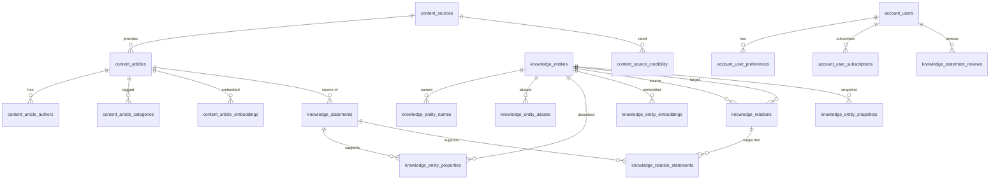

# ER Diagram v2.0

## 概述

本文档定义 Athena 在 PostgreSQL 中的物理数据模型。使用 Mermaid ER 图 + 详细表结构描述。

数据模型严格遵循 [Knowledge Model](../domain/knowledge-model.md) 的本体定义和 [DDD Detailed](../domain/ddd-detailed.md) 的聚合边界。

---

## 1. 全局 ER 图



---

## 2. Schema: content（内容管理）

### 2.1 content_sources

| 列 | 类型 | 约束 | 说明 |
|----|------|------|------|
| id | UUID | PK, DEFAULT gen_random_uuid() | |
| name | VARCHAR(255) | NOT NULL | 内容源名称 |
| source_type | VARCHAR(50) | NOT NULL, CHECK IN (rss,api,scraper,manual) | |
| url | TEXT | NOT NULL | 源 URL |
| language | VARCHAR(10) | NOT NULL | ISO 639-1 |
| fetch_interval_seconds | INTEGER | NOT NULL, DEFAULT 300 | 抓取间隔 |
| fetch_timeout_seconds | INTEGER | NOT NULL, DEFAULT 30 | 超时时间 |
| max_items_per_fetch | INTEGER | NOT NULL, DEFAULT 100 | 单次最大抓取数 |
| user_agent | VARCHAR(500) | DEFAULT ''Athena/1.0'' | |
| custom_headers | JSONB | DEFAULT ''{}'' | |
| status | VARCHAR(50) | NOT NULL, DEFAULT ''active'', CHECK IN (active,paused,error,deprecated) | |
| last_fetched_at | TIMESTAMPTZ | | 最后抓取时间 |
| fetch_error_count | INTEGER | NOT NULL, DEFAULT 0 | 连续错误计数 |
| total_articles_fetched | INTEGER | NOT NULL, DEFAULT 0 | |
| created_at | TIMESTAMPTZ | NOT NULL, DEFAULT now() | |
| updated_at | TIMESTAMPTZ | NOT NULL, DEFAULT now() | |
| deleted_at | TIMESTAMPTZ | | 软删除 |
| version | INTEGER | NOT NULL, DEFAULT 1 | 乐观锁 |

**索引**:
```sql
CREATE INDEX ix_sources_status ON content.content_sources(status) WHERE deleted_at IS NULL;
CREATE INDEX ix_sources_type ON content.content_sources(source_type);
CREATE INDEX ix_sources_language ON content.content_sources(language);
```

### 2.2 content_source_credibility

| 列 | 类型 | 约束 | 说明 |
|----|------|------|------|
| id | UUID | PK | |
| source_id | UUID | NOT NULL, FK → content_sources(id) | |
| credibility_score | NUMERIC(3,2) | NOT NULL, DEFAULT 0.50, CHECK (0.0-1.0) | |
| bias_leaning | VARCHAR(50) | | left, center-left, center, center-right, right |
| fact_check_rating | VARCHAR(100) | | 事实核查评级 |
| domain_authority | NUMERIC(3,2) | DEFAULT 0.50 | 领域权威性 |
| calculated_at | TIMESTAMPTZ | NOT NULL | 计算时间 |
| created_at | TIMESTAMPTZ | NOT NULL, DEFAULT now() | |

**索引**:
```sql
CREATE UNIQUE INDEX uq_source_credibility_source ON content.content_source_credibility(source_id);
```

### 2.3 content_articles

| 列 | 类型 | 约束 | 说明 |
|----|------|------|------|
| id | UUID | PK | |
| source_id | UUID | NOT NULL, FK → content_sources(id) | |
| url | TEXT | NOT NULL | 原始 URL |
| url_hash | VARCHAR(64) | NOT NULL | SHA-256，去重 |
| title | TEXT | NOT NULL | |
| content_raw | TEXT | | 原始 HTML/文本 |
| content_clean | TEXT | | 清洗后结构化文本 |
| summary | TEXT | | AI 摘要 |
| language | VARCHAR(10) | NOT NULL | ISO 639-1 |
| content_type | VARCHAR(50) | NOT NULL, DEFAULT ''article'' | article, paper, report, social_post, transcript |
| status | VARCHAR(50) | NOT NULL, DEFAULT ''draft'', CHECK IN (draft,published,archived,deleted) | |
| word_count | INTEGER | DEFAULT 0 | |
| reading_time_minutes | INTEGER | DEFAULT 0 | |
| published_at | TIMESTAMPTZ | | 原文发布时间 |
| fetched_at | TIMESTAMPTZ | NOT NULL, DEFAULT now() | 抓取时间 |
| image_urls | JSONB | DEFAULT ''[]'' | |
| source_metadata | JSONB | DEFAULT ''{}'' | 源特定元数据 |
| created_at | TIMESTAMPTZ | NOT NULL, DEFAULT now() | |
| updated_at | TIMESTAMPTZ | NOT NULL, DEFAULT now() | |
| deleted_at | TIMESTAMPTZ | | 软删除 |
| version | INTEGER | NOT NULL, DEFAULT 1 | |

**索引**:
```sql
CREATE UNIQUE INDEX uq_articles_url_hash ON content.content_articles(url_hash) WHERE deleted_at IS NULL;
CREATE INDEX ix_articles_source ON content.content_articles(source_id);
CREATE INDEX ix_articles_status ON content.content_articles(status) WHERE deleted_at IS NULL;
CREATE INDEX ix_articles_published ON content.content_articles(published_at DESC) WHERE deleted_at IS NULL;
CREATE INDEX ix_articles_language ON content.content_articles(language);
CREATE INDEX ix_articles_content_type ON content.content_articles(content_type);
```

### 2.4 content_article_authors

| 列 | 类型 | 约束 |
|----|------|------|
| id | UUID | PK |
| article_id | UUID | NOT NULL, FK → content_articles(id) |
| author_name | VARCHAR(500) | NOT NULL |
| display_order | INTEGER | NOT NULL, DEFAULT 0 |
| created_at | TIMESTAMPTZ | NOT NULL, DEFAULT now() |

**索引**:
```sql
CREATE INDEX ix_article_authors_article ON content.content_article_authors(article_id);
```

### 2.5 content_article_categories

| 列 | 类型 | 约束 |
|----|------|------|
| id | UUID | PK |
| article_id | UUID | NOT NULL, FK → content_articles(id) |
| category | VARCHAR(200) | NOT NULL |
| tag | VARCHAR(200) | |
| confidence | NUMERIC(3,2) | DEFAULT 1.00 |
| created_at | TIMESTAMPTZ | NOT NULL, DEFAULT now() |

**索引**:
```sql
CREATE INDEX ix_article_categories_article ON content.content_article_categories(article_id);
CREATE INDEX ix_article_categories_category ON content.content_article_categories(category);
CREATE INDEX ix_article_categories_tag ON content.content_article_categories(tag);
```

### 2.6 content_article_embeddings

| 列 | 类型 | 约束 | 说明 |
|----|------|------|------|
| id | UUID | PK | |
| article_id | UUID | NOT NULL, FK → content_articles(id) | |
| embedding | vector(1536) | NOT NULL | pgvector 向量 |
| model_name | VARCHAR(100) | NOT NULL | 使用的 Embedding 模型 |
| model_version | VARCHAR(50) | | |
| created_at | TIMESTAMPTZ | NOT NULL, DEFAULT now() | |

**索引**:
```sql
CREATE INDEX ix_article_embeddings_vector ON content.content_article_embeddings 
    USING ivfflat (embedding vector_cosine_ops) WITH (lists = 100);
```

---

## 3. Schema: knowledge（知识图谱）

### 3.1 knowledge_entities

| 列 | 类型 | 约束 | 说明 |
|----|------|------|------|
| id | UUID | PK | |
| canonical_name | VARCHAR(500) | NOT NULL | 规范名称 |
| entity_type | VARCHAR(50) | NOT NULL | person, org, location, event, concept, product, work, natural |
| description | TEXT | | |
| status | VARCHAR(50) | NOT NULL, DEFAULT ''draft'', CHECK IN (draft,active,deprecated,merged) | |
| merged_into | UUID | FK → knowledge_entities(id) | 合并目标 |
| created_at | TIMESTAMPTZ | NOT NULL, DEFAULT now() | |
| updated_at | TIMESTAMPTZ | NOT NULL, DEFAULT now() | |
| deleted_at | TIMESTAMPTZ | | 软删除 |
| version | INTEGER | NOT NULL, DEFAULT 1 | |

**索引**:
```sql
CREATE INDEX ix_entities_canonical_name ON knowledge.knowledge_entities(canonical_name);
CREATE INDEX ix_entities_type ON knowledge.knowledge_entities(entity_type);
CREATE INDEX ix_entities_status ON knowledge.knowledge_entities(status) WHERE deleted_at IS NULL;
```

### 3.2 knowledge_entity_names

| 列 | 类型 | 约束 | 说明 |
|----|------|------|------|
| id | UUID | PK | |
| entity_id | UUID | NOT NULL, FK → knowledge_entities(id) | |
| name | VARCHAR(500) | NOT NULL | |
| language | VARCHAR(10) | NOT NULL | ISO 639-1 |
| is_preferred | BOOLEAN | NOT NULL, DEFAULT false | |
| created_at | TIMESTAMPTZ | NOT NULL, DEFAULT now() | |

**索引**:
```sql
CREATE INDEX ix_entity_names_entity ON knowledge.knowledge_entity_names(entity_id);
CREATE INDEX ix_entity_names_name ON knowledge.knowledge_entity_names(name);
CREATE INDEX ix_entity_names_language ON knowledge.knowledge_entity_names(language);
CREATE UNIQUE INDEX uq_entity_names_preferred ON knowledge.knowledge_entity_names(entity_id, language) WHERE is_preferred = true;
```

### 3.3 knowledge_entity_aliases

| 列 | 类型 | 约束 | 说明 |
|----|------|------|------|
| id | UUID | PK | |
| entity_id | UUID | NOT NULL, FK → knowledge_entities(id) | |
| alias | VARCHAR(500) | NOT NULL | |
| alias_type | VARCHAR(50) | NOT NULL | acronym, former_name, nickname, transliteration, common_misspelling |
| language | VARCHAR(10) | | |
| created_at | TIMESTAMPTZ | NOT NULL, DEFAULT now() | |

**索引**:
```sql
CREATE INDEX ix_entity_aliases_entity ON knowledge.knowledge_entity_aliases(entity_id);
CREATE INDEX ix_entity_aliases_alias ON knowledge.knowledge_entity_aliases(alias);
```

### 3.4 knowledge_entity_properties

| 列 | 类型 | 约束 | 说明 |
|----|------|------|------|
| id | UUID | PK | |
| entity_id | UUID | NOT NULL, FK → knowledge_entities(id) | |
| key | VARCHAR(200) | NOT NULL | 属性名 |
| value | TEXT | NOT NULL | 属性值 |
| value_type | VARCHAR(50) | NOT NULL, DEFAULT ''string'' | string, number, date, boolean, json, uri |
| confidence | NUMERIC(3,2) | NOT NULL, DEFAULT 0.50, CHECK (0.0-1.0) | |
| source_statement_id | UUID | FK → knowledge_statements(id) | |
| valid_from | TIMESTAMPTZ | | 生效时间 |
| valid_until | TIMESTAMPTZ | | 失效时间 |
| needs_arbitration | BOOLEAN | NOT NULL, DEFAULT false | 需人工仲裁 |
| created_at | TIMESTAMPTZ | NOT NULL, DEFAULT now() | |

**索引**:
```sql
CREATE INDEX ix_entity_properties_entity ON knowledge.knowledge_entity_properties(entity_id);
CREATE INDEX ix_entity_properties_key ON knowledge.knowledge_entity_properties(key);
CREATE INDEX ix_entity_properties_statement ON knowledge.knowledge_entity_properties(source_statement_id);
CREATE INDEX ix_entity_properties_arbitration ON knowledge.knowledge_entity_properties(entity_id) WHERE needs_arbitration = true;
```

### 3.5 knowledge_entity_snapshots

| 列 | 类型 | 约束 | 说明 |
|----|------|------|------|
| id | UUID | PK | |
| entity_id | UUID | NOT NULL, FK → knowledge_entities(id) | |
| snapshot_at | TIMESTAMPTZ | NOT NULL | 快照时间点 |
| properties_snapshot | JSONB | NOT NULL | 该时间点的所有属性 |
| active_relations | JSONB | DEFAULT ''[]'' | 该时间点的活跃关系 ID 列表 |
| created_at | TIMESTAMPTZ | NOT NULL, DEFAULT now() | |

**索引**:
```sql
CREATE INDEX ix_entity_snapshots_entity_time ON knowledge.knowledge_entity_snapshots(entity_id, snapshot_at DESC);
```

### 3.6 knowledge_entity_embeddings

| 列 | 类型 | 约束 |
|----|------|------|
| id | UUID | PK |
| entity_id | UUID | NOT NULL, FK → knowledge_entities(id) |
| embedding | vector(1536) | NOT NULL |
| model_name | VARCHAR(100) | NOT NULL |
| created_at | TIMESTAMPTZ | NOT NULL, DEFAULT now() |

**索引**:
```sql
CREATE INDEX ix_entity_embeddings_vector ON knowledge.knowledge_entity_embeddings 
    USING ivfflat (embedding vector_cosine_ops) WITH (lists = 100);
```

### 3.7 knowledge_relations

| 列 | 类型 | 约束 | 说明 |
|----|------|------|------|
| id | UUID | PK | |
| relation_type | VARCHAR(50) | NOT NULL | INSTANCE_OF, PART_OF, WORKS_FOR, LOCATED_IN, etc. |
| source_entity_id | UUID | NOT NULL, FK → knowledge_entities(id) | |
| target_entity_id | UUID | NOT NULL, FK → knowledge_entities(id) | |
| properties | JSONB | DEFAULT ''{}'' | 扩展属性 |
| confidence | NUMERIC(3,2) | NOT NULL, DEFAULT 0.50, CHECK (0.0-1.0) | |
| valid_from | TIMESTAMPTZ | | 关系开始时间 |
| valid_until | TIMESTAMPTZ | | 关系结束时间 |
| status | VARCHAR(50) | NOT NULL, DEFAULT ''active'', CHECK IN (active,deprecated) | |
| created_at | TIMESTAMPTZ | NOT NULL, DEFAULT now() | |
| updated_at | TIMESTAMPTZ | NOT NULL, DEFAULT now() | |
| deleted_at | TIMESTAMPTZ | | |
| version | INTEGER | NOT NULL, DEFAULT 1 | |

**索引**:
```sql
CREATE INDEX ix_relations_source ON knowledge.knowledge_relations(source_entity_id);
CREATE INDEX ix_relations_target ON knowledge.knowledge_relations(target_entity_id);
CREATE INDEX ix_relations_type ON knowledge.knowledge_relations(relation_type);
CREATE INDEX ix_relations_status ON knowledge.knowledge_relations(status) WHERE deleted_at IS NULL;
CREATE UNIQUE INDEX uq_relations_triple ON knowledge.knowledge_relations(source_entity_id, target_entity_id, relation_type) WHERE deleted_at IS NULL AND status = ''active'';
```

### 3.8 knowledge_relation_statements

| 列 | 类型 | 约束 | 说明 |
|----|------|------|------|
| id | UUID | PK | |
| relation_id | UUID | NOT NULL, FK → knowledge_relations(id) | |
| statement_id | UUID | NOT NULL, FK → knowledge_statements(id) | |

**索引**:
```sql
CREATE UNIQUE INDEX uq_relation_statements ON knowledge.knowledge_relation_statements(relation_id, statement_id);
```

### 3.9 knowledge_statements

| 列 | 类型 | 约束 | 说明 |
|----|------|------|------|
| id | UUID | PK | |
| statement_type | VARCHAR(50) | NOT NULL | entity_extraction, relation_extraction, manual |
| subject_id | UUID | NOT NULL | 声明对象（实体或关系 ID） |
| predicate | VARCHAR(200) | NOT NULL | |
| object_value | TEXT | NOT NULL | |
| confidence | NUMERIC(3,2) | NOT NULL, DEFAULT 0.50 | |
| extraction_method | VARCHAR(200) | | 模型标识 或 ''manual'' |
| source_article_id | UUID | NOT NULL, FK → content_articles(id) | |
| source_snippet | TEXT | | 原文摘录 |
| source_position | INTEGER | | 文章内位置 |
| reviewer_id | UUID | FK → account_users(id) | |
| review_status | VARCHAR(50) | NOT NULL, DEFAULT ''pending'', CHECK IN (pending,approved,rejected) | |
| review_comment | TEXT | | |
| created_at | TIMESTAMPTZ | NOT NULL, DEFAULT now() | |
| updated_at | TIMESTAMPTZ | NOT NULL, DEFAULT now() | |

**索引**:
```sql
CREATE INDEX ix_statements_subject ON knowledge.knowledge_statements(subject_id);
CREATE INDEX ix_statements_type ON knowledge.knowledge_statements(statement_type);
CREATE INDEX ix_statements_review ON knowledge.knowledge_statements(review_status) WHERE review_status = ''pending'';
CREATE INDEX ix_statements_source_article ON knowledge.knowledge_statements(source_article_id);
CREATE INDEX ix_statements_reviewer ON knowledge.knowledge_statements(reviewer_id);
```

---

## 4. Schema: account（用户账户）

### 4.1 account_users

| 列 | 类型 | 约束 |
|----|------|------|
| id | UUID | PK |
| email | VARCHAR(255) | NOT NULL, UNIQUE |
| display_name | VARCHAR(200) | NOT NULL |
| password_hash | VARCHAR(255) | NOT NULL |
| subscription_tier | VARCHAR(50) | NOT NULL, DEFAULT ''free'', CHECK IN (free,pro,enterprise) |
| role | VARCHAR(50) | NOT NULL, DEFAULT ''user'', CHECK IN (user,moderator,admin) |
| status | VARCHAR(50) | NOT NULL, DEFAULT ''active'', CHECK IN (active,suspended,deleted) |
| last_login_at | TIMESTAMPTZ | |
| created_at | TIMESTAMPTZ | NOT NULL, DEFAULT now() |
| updated_at | TIMESTAMPTZ | NOT NULL, DEFAULT now() |
| deleted_at | TIMESTAMPTZ | |
| version | INTEGER | NOT NULL, DEFAULT 1 |

**索引**:
```sql
CREATE UNIQUE INDEX uq_users_email ON account.account_users(email) WHERE deleted_at IS NULL;
```

### 4.2 account_user_preferences

| 列 | 类型 | 约束 |
|----|------|------|
| id | UUID | PK |
| user_id | UUID | NOT NULL, FK → account_users(id), UNIQUE |
| language | VARCHAR(10) | NOT NULL, DEFAULT ''en'' |
| topics | JSONB | DEFAULT ''[]'' |
| sources | JSONB | DEFAULT ''[]'' |
| email_enabled | BOOLEAN | NOT NULL, DEFAULT true |
| push_enabled | BOOLEAN | NOT NULL, DEFAULT true |
| daily_digest | BOOLEAN | NOT NULL, DEFAULT true |
| breaking_news | BOOLEAN | NOT NULL, DEFAULT true |
| quiet_hours_start | INTEGER | DEFAULT 22 |
| quiet_hours_end | INTEGER | DEFAULT 7 |
| ui_settings | JSONB | DEFAULT ''{}'' |
| updated_at | TIMESTAMPTZ | NOT NULL, DEFAULT now() |

---

## 5. Schema: system（系统管理）

### 5.1 system_plugin_registry

| 列 | 类型 | 约束 |
|----|------|------|
| id | UUID | PK |
| plugin_name | VARCHAR(200) | NOT NULL, UNIQUE |
| plugin_type | VARCHAR(50) | NOT NULL |
| version | VARCHAR(50) | NOT NULL |
| entrypoint | VARCHAR(500) | NOT NULL |
| manifest | JSONB | NOT NULL |
| status | VARCHAR(50) | NOT NULL, DEFAULT ''registered'' |
| loaded_at | TIMESTAMPTZ | |
| created_at | TIMESTAMPTZ | NOT NULL, DEFAULT now() |

### 5.2 system_event_log

| 列 | 类型 | 约束 | 说明 |
|----|------|------|------|
| id | UUID | PK | |
| event_type | VARCHAR(200) | NOT NULL | 事件类型 |
| aggregate_id | UUID | NOT NULL | 聚合根 ID |
| aggregate_type | VARCHAR(200) | NOT NULL | 聚合根类型 |
| payload | JSONB | NOT NULL | 事件负载 |
| occurred_at | TIMESTAMPTZ | NOT NULL | |
| created_at | TIMESTAMPTZ | NOT NULL, DEFAULT now() | |

**索引**:
```sql
CREATE INDEX ix_event_log_type ON system.system_event_log(event_type);
CREATE INDEX ix_event_log_aggregate ON system.system_event_log(aggregate_id, aggregate_type);
CREATE INDEX ix_event_log_occurred ON system.system_event_log(occurred_at DESC);
```

---

## 6. 迁移策略

### 6.1 初始迁移顺序

1. `content_sources` + `content_source_credibility`
2. `account_users` + `account_user_preferences`
3. `content_articles` + `content_article_authors` + `content_article_categories`
4. `knowledge_entities` + `knowledge_entity_names` + `knowledge_entity_aliases`
5. `knowledge_statements`
6. `knowledge_entity_properties`
7. `knowledge_relations` + `knowledge_relation_statements`
8. `knowledge_entity_snapshots`
9. `content_article_embeddings` + `knowledge_entity_embeddings`
10. `system_plugin_registry` + `system_event_log`

### 6.2 扩展预留

- 全文搜索索引不在 PG 内（使用 Elasticsearch）
- 图查询索引不在 PG 内（使用 Neo4j）
- 向量索引需 `pgvector` 扩展
- `deleted_at` 列支持软删除，Phase 3+ 可引入 `deleted_at` 分区裁剪

---

*本文档通过 Alembic 迁移脚本实现，所有 Schema 变更需对应 ADR 记录。*
