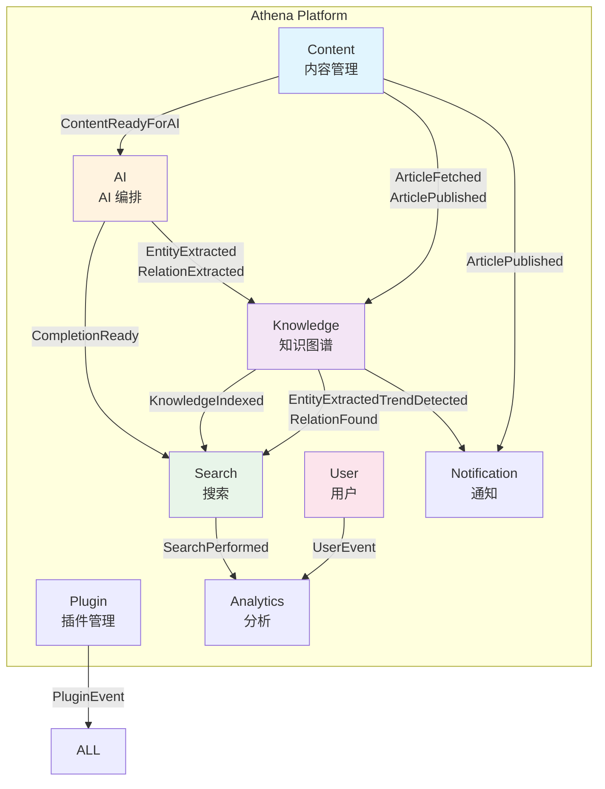

# DDD Detailed Design v2.0

## 概述

本文档是 [domain-model.md](domain-model.md) 的深化版，提供每个限界上下文的完整 DDD 战术设计，
包括聚合根、实体、值对象、领域服务、仓储接口和应用服务。

---

## 1. 上下文映射（Context Map）



### 上下文关系类型

| 上游 | 下游 | 关系类型 | 说明 |
|------|------|----------|------|
| Content | Knowledge | 发布者-订阅者 | Content 发布事件，Knowledge 异步消费 |
| Content | AI | 客户-供应商 | Content 请求 AI 处理 |
| Knowledge | Search | 发布者-订阅者 | Knowledge 更新触发 Search 重索引 |
| AI | Knowledge | 发布者-订阅者 | AI 提取结果写入 Knowledge |
| User | All | 共享内核 | UserId 为全局通用标识 |

---

## 2. Shared Kernel（共享内核）

所有限界上下文共享的基础类型。

### 2.1 值对象

```python
# ── 标识符 ──
class EntityId(UUID): ...
class ArticleId(UUID): ...
class SourceId(UUID): ...
class UserId(UUID): ...
class StatementId(UUID): ...

# ── 通用值对象 ──
@dataclass(frozen=True)
class Language:
    code: str  # ISO 639-1
    name: str
    
    @staticmethod
    def from_code(code: str) -> "Language": ...

@dataclass(frozen=True)
class HttpUrl:
    value: str
    
    def __post_init__(self):
        if not self._is_valid_url(self.value):
            raise ValueError(f"Invalid URL: {self.value}")

@dataclass(frozen=True)
class Confidence:
    value: float
    
    def __post_init__(self):
        if not (0.0 <= self.value <= 1.0):
            raise ValueError("Confidence must be between 0.0 and 1.0")

@dataclass(frozen=True)
class Money:
    amount: Decimal
    currency: str  # ISO 4217

@dataclass(frozen=True)
class DateRange:
    start: datetime
    end: datetime | None
    
    def contains(self, dt: datetime) -> bool: ...

# ── 分页 ──
@dataclass(frozen=True)
class Pagination:
    page: int = 1
    size: int = 20
    
    @property
    def offset(self) -> int:
        return (self.page - 1) * self.size

@dataclass(frozen=True)
class Cursor:
    value: str
```

### 2.2 基类

```python
class DomainEvent(ABC):
    event_id: UUID = field(default_factory=uuid4)
    occurred_at: datetime = field(default_factory=utcnow)
    
class AggregateRoot(ABC):
    id: UUID
    version: int = 1
    _events: list[DomainEvent] = field(default_factory=list, init=False)
    
    def add_event(self, event: DomainEvent) -> None:
        self._events.append(event)
    
    def collect_events(self) -> list[DomainEvent]:
        events, self._events = self._events, []
        return events

class Entity(ABC):
    id: UUID
    
class ValueObject(ABC):
    """不可变值对象基类"""
```

---

## 3. Content Context（内容上下文）

### 3.1 上下文职责

管理多源内容的完整生命周期：接入 → 清洗 → 标准化 → 存储 → 分发。

### 3.2 聚合根

#### Source（内容源）

```python
class Source(AggregateRoot):
    """内容源聚合根"""
    id: SourceId
    name: str
    source_type: SourceType          # rss | api | scraper | manual
    url: HttpUrl
    language: Language
    fetch_config: FetchConfig
    credibility: SourceCredibility    # 来源可信度
    status: SourceStatus              # active | paused | error | deprecated
    last_fetched_at: datetime | None
    fetch_error_count: int = 0
    total_articles_fetched: int = 0
    
    def pause(self) -> None:
        """暂停内容源"""
        if self.status != SourceStatus.ACTIVE:
            raise DomainError("Only active source can be paused")
        self.status = SourceStatus.PAUSED
        self.add_event(SourcePaused(source_id=self.id))
    
    def resume(self) -> None:
        """恢复内容源"""
        self.status = SourceStatus.ACTIVE
        self.add_event(SourceResumed(source_id=self.id))
    
    def record_fetch_error(self) -> None:
        self.fetch_error_count += 1
        if self.fetch_error_count >= 10:
            self.status = SourceStatus.ERROR
            self.add_event(SourceErrored(source_id=self.id))
```

#### Article（文章）

```python
class Article(AggregateRoot):
    """文章聚合根"""
    id: ArticleId
    source_id: SourceId
    url: HttpUrl
    url_hash: str                   # SHA-256，去重唯一键
    title: str
    content_raw: str                # 原始内容（HTML 或纯文本）
    content_clean: str | None       # 清洗后的结构化文本
    summary: str | None             # AI 摘要
    language: Language
    authors: list[str] = []
    published_at: datetime
    fetched_at: datetime
    status: ArticleStatus           # draft | published | archived | deleted
    content_type: ContentType       # article | paper | report | social_post | transcript
    word_count: int = 0
    reading_time_minutes: int = 0
    image_urls: list[HttpUrl] = []
    categories: list[str] = []
    tags: list[str] = []
    source_metadata: dict = {}
    embedding: list[float] | None = None  # 文章向量（用于语义搜索）
    
    def publish(self) -> None:
        """发布文章"""
        if self.status != ArticleStatus.DRAFT:
            raise DomainError("Only draft article can be published")
        self.status = ArticleStatus.PUBLISHED
        self.add_event(ArticlePublished(article_id=self.id))
    
    def archive(self) -> None:
        """归档文章"""
        self.status = ArticleStatus.ARCHIVED
        self.add_event(ArticleArchived(article_id=self.id))
    
    def attach_summary(self, summary: str) -> None:
        """附加 AI 摘要"""
        self.summary = summary
        self.add_event(ArticleSummarized(article_id=self.id))
```

### 3.3 值对象

```python
@dataclass(frozen=True)
class FetchConfig:
    interval_seconds: int = 300
    timeout_seconds: int = 30
    max_items_per_fetch: int = 100
    user_agent: str = "Athena/1.0"
    custom_headers: dict = {}

@dataclass(frozen=True)
class SourceCredibility:
    credibility_score: float = 0.5
    bias_leaning: str | None = None    # left | center-left | center | center-right | right
    fact_check_rating: str | None = None
    domain_authority: float = 0.5

class SourceType(str, Enum):
    RSS = "rss"
    API = "api"
    SCRAPER = "scraper"
    MANUAL = "manual"

class SourceStatus(str, Enum):
    ACTIVE = "active"
    PAUSED = "paused"
    ERROR = "error"
    DEPRECATED = "deprecated"

class ArticleStatus(str, Enum):
    DRAFT = "draft"
    PUBLISHED = "published"
    ARCHIVED = "archived"
    DELETED = "deleted"

class ContentType(str, Enum):
    ARTICLE = "article"
    PAPER = "paper"
    REPORT = "report"
    SOCIAL_POST = "social_post"
    TRANSCRIPT = "transcript"
```

### 3.4 仓储接口

```python
class ISourceRepository(ABC):
    async def save(self, source: Source) -> None: ...
    async def find_by_id(self, id: SourceId) -> Source | None: ...
    async def find_active(self) -> list[Source]: ...
    async def find_by_type(self, type: SourceType) -> list[Source]: ...
    async def delete(self, id: SourceId) -> None: ...

class IArticleRepository(ABC):
    async def save(self, article: Article) -> None: ...
    async def find_by_id(self, id: ArticleId) -> Article | None: ...
    async def find_by_url_hash(self, hash: str) -> Article | None: ...
    async def find_by_source(self, source_id: SourceId, pagination: Pagination) -> list[Article]: ...
    async def search(self, query: str, pagination: Pagination) -> list[Article]: ...
    async def find_duplicates(self, url_hash: str, similarity_threshold: float) -> list[Article]: ...
```

### 3.5 领域服务

```python
class ContentIngestionService:
    """内容接入编排服务"""
    def __init__(
        self,
        source_repo: ISourceRepository,
        article_repo: IArticleRepository,
        cleaning_service: ContentCleaningService,
        duplicate_service: DuplicateDetectionService,
        event_bus: IEventBus,
    ): ...
    
    async def ingest_source(self, source_id: SourceId) -> IngestionResult:
        """接入指定源的内容"""
        ...

class ContentCleaningService:
    """内容清洗服务"""
    async def clean_html(self, raw_html: str, url: HttpUrl) -> str: ...
    async def extract_main_content(self, html: str) -> str: ...
    async def detect_language(self, text: str) -> Language: ...
    async def normalize_whitespace(self, text: str) -> str: ...

class DuplicateDetectionService:
    """去重服务"""
    async def find_existing(self, url_hash: str) -> Article | None: ...
    async def find_similar(self, article: Article, threshold: float) -> list[Article]: ...
    async def is_duplicate(self, article: Article) -> bool: ...
```

### 3.6 应用服务

```python
class SourceManagementAppService:
    """内容源管理"""
    async def register_source(self, cmd: RegisterSourceCommand) -> SourceId: ...
    async def update_source(self, cmd: UpdateSourceCommand) -> None: ...
    async def pause_source(self, source_id: SourceId) -> None: ...
    async def list_sources(self, query: ListSourcesQuery) -> list[SourceDTO]: ...

class ArticleQueryAppService:
    """文章查询（读模型）"""
    async def get_article(self, id: ArticleId) -> ArticleDetailDTO: ...
    async def list_articles(self, query: ListArticlesQuery) -> PaginatedResult[ArticleDTO]: ...
    async def get_trending(self, hours: int = 24) -> list[ArticleDTO]: ...
```

---

## 4. Knowledge Context（知识上下文）

### 4.1 上下文职责

管理知识图谱的完整生命周期：实体管理、关系管理、声明管理、图谱查询。

### 4.2 聚合根

#### KnowledgeEntity（知识实体）

```python
class KnowledgeEntity(AggregateRoot):
    """知识实体聚合根"""
    id: EntityId
    canonical_name: str
    entity_type: EntityType
    names: list[EntityName]           # 多语言名称
    aliases: list[EntityAlias]        # 别名
    properties: list[EntityProperty]  # EAV 属性
    description: str | None
    status: EntityStatus              # draft | active | deprecated | merged
    merged_into: EntityId | None      # 被合并到的目标实体
    created_at: datetime
    updated_at: datetime
    
    def add_name(self, name: str, language: str, is_preferred: bool = False) -> None:
        """添加多语言名称"""
        if is_preferred:
            for n in self.names:
                if n.language == language:
                    n.is_preferred = False
        self.names.append(EntityName(name=name, language=language, is_preferred=is_preferred))
    
    def add_property(self, prop: EntityProperty) -> None:
        """添加属性（自动处理冲突）"""
        existing = [p for p in self.properties if p.key == prop.key]
        if existing:
            # 冲突属性保留，标记为需要人工仲裁
            prop.needs_arbitration = True
        self.properties.append(prop)
    
    def merge_into(self, target_id: EntityId) -> None:
        """合并到另一个实体"""
        self.status = EntityStatus.MERGED
        self.merged_into = target_id
        self.add_event(EntityMerged(source_id=self.id, target_id=target_id))
    
    def deprecate(self) -> None:
        self.status = EntityStatus.DEPRECATED
        self.add_event(EntityDeprecated(entity_id=self.id))
```

#### KnowledgeRelation（知识关系）

```python
class KnowledgeRelation(AggregateRoot):
    """知识关系聚合根"""
    id: RelationId
    relation_type: RelationType
    source_entity_id: EntityId
    target_entity_id: EntityId
    properties: dict                  # 扩展属性
    statements: list[StatementId]      # 支撑声明
    confidence: Confidence
    valid_period: DateRange | None
    status: RelationStatus             # active | deprecated
    created_at: datetime
    updated_at: datetime
    
    def add_statement(self, statement_id: StatementId) -> None:
        self.statements.append(statement_id)
        self._recalculate_confidence()
    
    def deprecate(self, reason: str) -> None:
        self.status = RelationStatus.DEPRECATED
        self.properties["deprecation_reason"] = reason
        self.add_event(RelationDeprecated(relation_id=self.id))
```

#### Statement（声明）

```python
class Statement(AggregateRoot):
    """声明聚合根"""
    id: StatementId
    statement_type: StatementType
    subject_id: UUID              # 声明对象（实体ID 或 关系ID）
    predicate: str                # 属性名
    object_value: str             # 属性值
    confidence: Confidence
    extraction_method: str        # 模型标识 或 "manual"
    source: StatementSource       # 溯源信息
    reviewer_id: UserId | None
    review_status: ReviewStatus   # pending | approved | rejected
    created_at: datetime
    
    def approve(self, reviewer_id: UserId) -> None:
        self.reviewer_id = reviewer_id
        self.review_status = ReviewStatus.APPROVED
        self.add_event(StatementApproved(statement_id=self.id))
    
    def reject(self, reviewer_id: UserId, reason: str) -> None:
        self.reviewer_id = reviewer_id
        self.review_status = ReviewStatus.REJECTED
        self.add_event(StatementRejected(statement_id=self.id, reason=reason))
```

### 4.3 值对象

```python
@dataclass(frozen=True)
class EntityName:
    name: str
    language: str
    is_preferred: bool = False

@dataclass(frozen=True)
class EntityAlias:
    alias: str
    alias_type: AliasType

class AliasType(str, Enum):
    ACRONYM = "acronym"
    FORMER_NAME = "former_name"
    NICKNAME = "nickname"
    TRANSLITERATION = "transliteration"
    COMMON_MISSPELLING = "common_misspelling"

@dataclass(frozen=True)
class EntityProperty:
    key: str
    value: str
    value_type: PropertyValueType
    confidence: Confidence
    source_statement_id: StatementId | None
    valid_from: datetime | None
    valid_until: datetime | None
    needs_arbitration: bool = False

class PropertyValueType(str, Enum):
    STRING = "string"
    NUMBER = "number"
    DATE = "date"
    BOOLEAN = "boolean"
    JSON = "json"
    URI = "uri"

@dataclass(frozen=True)
class StatementSource:
    article_id: ArticleId
    snippet: str
    position: int

class StatementType(str, Enum):
    ENTITY_EXTRACTION = "entity_extraction"
    RELATION_EXTRACTION = "relation_extraction"
    MANUAL = "manual"

class ReviewStatus(str, Enum):
    PENDING = "pending"
    APPROVED = "approved"
    REJECTED = "rejected"

class EntityStatus(str, Enum):
    DRAFT = "draft"
    ACTIVE = "active"
    DEPRECATED = "deprecated"
    MERGED = "merged"

class RelationStatus(str, Enum):
    ACTIVE = "active"
    DEPRECATED = "deprecated"
```

### 4.4 仓储接口

```python
class IEntityRepository(ABC):
    async def save(self, entity: KnowledgeEntity) -> None: ...
    async def find_by_id(self, id: EntityId) -> KnowledgeEntity | None: ...
    async def find_by_name(self, name: str, language: str = "en") -> list[KnowledgeEntity]: ...
    async def search(self, query: str, entity_types: list[EntityType] | None = None) -> list[KnowledgeEntity]: ...
    async def find_by_article(self, article_id: ArticleId) -> list[KnowledgeEntity]: ...

class IRelationRepository(ABC):
    async def save(self, relation: KnowledgeRelation) -> None: ...
    async def find_by_id(self, id: RelationId) -> KnowledgeRelation | None: ...
    async def find_by_entity(self, entity_id: EntityId, relation_type: RelationType | None = None) -> list[KnowledgeRelation]: ...
    async def find_between(self, source_id: EntityId, target_id: EntityId) -> list[KnowledgeRelation]: ...

class IStatementRepository(ABC):
    async def save(self, statement: Statement) -> None: ...
    async def find_by_id(self, id: StatementId) -> Statement | None: ...
    async def find_by_subject(self, subject_id: UUID) -> list[Statement]: ...
    async def find_pending_review(self, limit: int = 100) -> list[Statement]: ...
```

### 4.5 领域服务

```python
class EntityLinkingService:
    """实体链接与消歧服务"""
    async def link_entity(self, name: str, context: str) -> EntityId | None:
        """给定名称和上下文，找到最匹配的现有实体，否则返回 None"""
        ...
    
    async def disambiguate(self, entity_a: EntityId, entity_b: EntityId) -> DisambiguationResult:
        """判断两个实体是否应合并"""
        ...
    
    async def resolve_coreference(self, text: str, entities: list[EntityId]) -> dict[str, EntityId]:
        """解析共指消解"""
        ...

class EntityExtractionService:
    """从文本中提取新实体"""
    async def extract(self, article: Article) -> list[Statement]:
        """调用 AI 插件提取命名实体，返回声明列表"""
        ...

class RelationExtractionService:
    """从文本中提取关系"""
    async def extract(self, article: Article, entities: list[EntityId]) -> list[Statement]:
        """调用 AI 插件提取实体间关系，返回声明列表"""
        ...

class KnowledgeAggregationService:
    """声明聚合为知识"""
    async def aggregate_entity(self, statements: list[Statement]) -> KnowledgeEntity:
        """将多条声明合并为一个实体"""
        ...
    
    async def aggregate_relation(self, statements: list[Statement]) -> KnowledgeRelation:
        """将多条声明合并为一条关系"""
        ...
    
    async def resolve_conflicts(self, entity_id: EntityId) -> ConflictReport:
        """检测并报告实体属性冲突"""
        ...

class GraphQueryService:
    """图谱查询服务"""
    async def query_path(self, from_entity: EntityId, to_entity: EntityId, max_depth: int = 3) -> list[Path]: ...
    async def query_subgraph(self, entity_id: EntityId, depth: int = 1) -> Subgraph: ...
    async def query_neighbors(self, entity_id: EntityId, relation_types: list[RelationType] | None = None) -> list[tuple[KnowledgeRelation, KnowledgeEntity]]: ...
    async def centrality_analysis(self, entity_id: EntityId) -> CentralityMetrics: ...
```

### 4.6 应用服务

```python
class KnowledgeManagementAppService:
    async def review_statement(self, cmd: ReviewStatementCommand) -> None: ...
    async def merge_entities(self, cmd: MergeEntitiesCommand) -> None: ...
    async def approve_entity(self, entity_id: EntityId) -> None: ...

class KnowledgeQueryAppService:
    async def get_entity_detail(self, id: EntityId, language: str = "en") -> EntityDetailDTO: ...
    async def search_entities(self, query: SearchEntitiesQuery) -> PaginatedResult[EntityDTO]: ...
    async def get_graph(self, entity_id: EntityId, depth: int = 1) -> GraphDTO: ...
    async def get_entity_timeline(self, entity_id: EntityId) -> TimelineDTO: ...
```

---

## 5. Search Context（搜索上下文）

### 5.1 聚合根

#### SearchIndex

```python
class SearchIndex(AggregateRoot):
    """搜索索引聚合根"""
    id: IndexId
    name: str
    index_type: IndexType            # fulltext | vector | hybrid
    document_count: int = 0
    status: IndexStatus
    last_rebuilt_at: datetime | None
    config: IndexConfig
    
    def rebuild(self) -> None:
        self.add_event(IndexRebuildRequested(index_id=self.id))
```

### 5.2 值对象

```python
@dataclass(frozen=True)
class SearchQuery:
    text: str
    language: Language | None = None
    filters: dict = {}
    sort: SortConfig | None = None
    pagination: Pagination = Pagination()
    search_mode: SearchMode = SearchMode.HYBRID

class SearchMode(str, Enum):
    FULLTEXT = "fulltext"
    VECTOR = "vector"
    HYBRID = "hybrid"

@dataclass(frozen=True)
class SearchResultItem:
    document_id: UUID
    document_type: DocumentType  # article | entity
    score: float
    highlights: dict[str, list[str]]
    source: SearchMode

class DocumentType(str, Enum):
    ARTICLE = "article"
    ENTITY = "entity"

@dataclass(frozen=True)
class SortConfig:
    field: str
    order: str = "desc"  # asc | desc
```

### 5.3 仓储接口

```python
class ISearchRepository(ABC):
    async def index(self, document: SearchDocument) -> None: ...
    async def bulk_index(self, documents: list[SearchDocument]) -> None: ...
    async def search(self, query: SearchQuery) -> SearchResult: ...
    async def delete(self, document_id: UUID) -> None: ...
    async def rebuild_index(self, index_id: IndexId) -> None: ...
```

### 5.4 领域服务

```python
class SearchOrchestrationService:
    async def search(self, query: SearchQuery) -> SearchResult:
        """编排全文搜索和向量搜索，融合结果"""
        ...
    
    async def hybrid_rank(self, fulltext_results: list, vector_results: list) -> list:
        """RRF (Reciprocal Rank Fusion) 融合排序"""
        ...
```

---

## 6. AI Context（AI 上下文）

### 6.1 聚合根

```python
class CompletionTask(AggregateRoot):
    """AI 完成任务聚合根"""
    id: TaskId
    prompt_id: PromptId
    model: str
    input: dict
    output: CompletionResult | None
    status: TaskStatus              # pending | running | completed | failed
    tokens_used: int = 0
    cost: Money | None
    latency_ms: int = 0
    retry_count: int = 0
    max_retries: int = 3
    created_at: datetime
    completed_at: datetime | None
    
    def start(self) -> None:
        self.status = TaskStatus.RUNNING
        self.add_event(TaskStarted(task_id=self.id))
    
    def complete(self, result: CompletionResult) -> None:
        self.output = result
        self.status = TaskStatus.COMPLETED
        self.tokens_used = result.tokens_used
        self.cost = result.cost
        self.latency_ms = result.latency_ms
        self.completed_at = utcnow()
        self.add_event(TaskCompleted(task_id=self.id))
    
    def fail(self, error: str) -> None:
        self.retry_count += 1
        if self.retry_count >= self.max_retries:
            self.status = TaskStatus.FAILED
        self.add_event(TaskFailed(task_id=self.id, error=error, retry_count=self.retry_count))
```

### 6.2 领域服务

```python
class ModelRouter:
    """模型路由服务"""
    async def route(self, requirements: ModelRequirements) -> IAIProviderPlugin:
        """根据需求（成本、延迟、能力）选择最优模型提供商"""
        ...
    
    async def fallback(self, error: Exception) -> IAIProviderPlugin:
        """失败时切换到备用模型"""
        ...

class PromptCompiler:
    """Prompt 编译服务"""
    async def compile(self, template: PromptTemplate, variables: dict) -> str:
        """将 Jinja2 模板 + 变量编译为最终 Prompt"""
        ...
```

---

## 7. User Context（用户上下文）

### 7.1 聚合根

```python
class User(AggregateRoot):
    """用户聚合根"""
    id: UserId
    email: str
    display_name: str
    preferences: UserPreferences
    subscription_tier: SubscriptionTier  # free | pro | enterprise
    role: UserRole                       # user | moderator | admin
    status: UserStatus
    created_at: datetime
    last_login_at: datetime | None
    
    def update_preferences(self, prefs: UserPreferences) -> None:
        self.preferences = prefs
        self.add_event(UserPreferencesUpdated(user_id=self.id))
    
    def upgrade_subscription(self, tier: SubscriptionTier) -> None:
        self.subscription_tier = tier
        self.add_event(SubscriptionChanged(user_id=self.id, tier=tier))
```

### 7.2 值对象

```python
@dataclass(frozen=True)
class UserPreferences:
    language: Language
    topics: list[str] = []
    sources: list[SourceId] = []
    notification: NotificationSettings = NotificationSettings()

@dataclass(frozen=True)
class NotificationSettings:
    email_enabled: bool = True
    push_enabled: bool = True
    daily_digest: bool = True
    breaking_news: bool = True
    quiet_hours: tuple[int, int] = (22, 7)  # start_hour, end_hour
```

---

## 8. 跨上下文通信

### 8.1 事件总线抽象

```python
class IEventBus(ABC):
    async def publish(self, event: DomainEvent) -> None: ...
    async def subscribe(self, event_type: type, handler: EventHandler) -> None: ...

class IEventHandler(ABC):
    async def handle(self, event: DomainEvent) -> None: ...
```

### 8.2 关键集成流程

**内容接入 → 知识抽取**:
```
1. ContentIngestionService.ingest_source()
2. 发布 ArticleFetched 事件
3. EntityExtractionService 消费 → 提取实体
4. RelationExtractionService 消费 → 提取关系
5. 发布 EntityExtracted / RelationFound 事件
6. SearchIndexService 消费 → 索引更新
```

---

*本文档为 DDD 战术设计的完整参考。实现细节在对应 RFC 中确定。*
