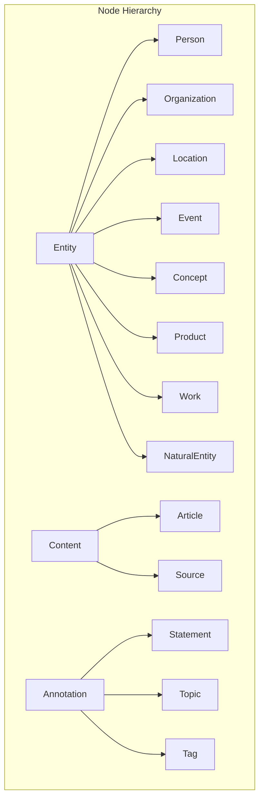

# Graph Model v2.0

## 概述

本文档定义 Athena 在 Neo4j（属性图数据库）中的图模型设计。

与 PostgreSQL ER Diagram 的互补关系：
- **ER Diagram** 负责：事务一致性、JOIN 查询、聚合统计
- **Graph Model** 负责：路径遍历、子图匹配、中心性分析、图模式发现

---

## 1. 节点类型（Node Labels）

### 1.1 节点层级



### 1.2 节点属性规范

#### Entity（基类节点）

```
(:Entity) {
    id: String,               # "ent_{uuid}"
    canonical_name: String,
    entity_type: String,      # Person | Organization | Location | ...
    description: String?,
    status: String,           # draft | active | deprecated | merged
    confidence: Float,        # 0.0 - 1.0
    source_count: Integer,    # 支撑来源数（冗余，加速查询）
    created_at: DateTime,
    updated_at: DateTime
}
```

#### Person（人物）

```
(:Person:Entity) {
    -- 继承 Entity 所有属性 --
    birth_date: Date?,
    death_date: Date?,
    nationality: String?,
    gender: String?,
    occupations: List[String],
    notable_works: List[String]
}
```

#### Organization（组织）

```
(:Organization:Entity) {
    founded_date: Date?,
    headquarters: String?,
    industry: String?,
    employee_count: Integer?,
    market_cap: Float?,
    ticker_symbol: String?
}
```

#### Location（地点）

```
(:Location:Entity) {
    latitude: Float?,
    longitude: Float?,
    population: Integer?,
    area_km2: Float?,
    country_code: String?,
    timezone: String?
}
```

#### Event（事件）

```
(:Event:Entity) {
    start_date: Date?,
    end_date: Date?,
    event_scale: String?,     # local | national | international
    casualties: Integer?,
    economic_impact: Float?
}
```

#### Article（文章）

```
(:Article:Content) {
    id: String,               # "art_{uuid}"
    title: String,
    url: String,
    language: String,
    published_at: DateTime,
    source_name: String,
    word_count: Integer,
    summary: String?
}
```

#### Source（来源）

```
(:Source:Content) {
    id: String,
    name: String,
    source_type: String,
    language: String,
    credibility_score: Float
}
```

#### Statement（声明）

```
(:Statement:Annotation) {
    id: String,
    statement_type: String,   # entity_extraction | relation_extraction | manual
    predicate: String,
    object_value: String,
    confidence: Float,
    review_status: String,
    snippet: String?          # 原文摘录
}
```

#### Topic（主题）

```
(:Topic) {
    id: String,
    name: String,
    name_zh: String?,
    description: String?,
    article_count: Integer    # 冗余计数
}
```

---

## 2. 边类型（Relationship Types）

### 2.1 边类型目录

```yaml
# ── 层级关系 ──
INSTANCE_OF:       Entity → Entity    # 实例归属
SUBCLASS_OF:       Entity → Entity    # 子类
PART_OF:           Entity → Entity    # 部分-整体
MEMBER_OF:         Entity → Entity    # 成员

# ── 人际/组织关系 ──
WORKS_FOR:         Person → Organization
FOUNDED:           Person → Organization
LED_BY:            Organization → Person
COLLABORATED_WITH: Person → Person
COMPETES_WITH:     Organization → Organization
ACQUIRED:          Organization → Organization
INVESTED_IN:       Organization → Organization | Person → Organization

# ── 地理关系 ──
LOCATED_IN:        Entity → Location
BORDERS:           Location → Location
NEAR:              Location → Location
TRAVELED_TO:       Person → Location

# ── 事件关系 ──
PARTICIPATED_IN:   Entity → Event
ORGANIZED:         Entity → Event
CAUSED:            Event → Event
PRECEDED:          Event → Event
OCCURRED_AT:       Event → Location

# ── 知识关系 ──
RELATED_TO:        Entity → Entity     # 通用关联
SIMILAR_TO:        Entity → Entity     # 相似
OPPOSITE_OF:       Entity → Entity     # 对立
CITED:             Article → Article
INFLUENCED:        Entity → Entity

# ── 内容关系 ──
PUBLISHED_BY:      Article → Source
MENTIONS:          Article → Entity    # 文章提及实体
EXTRACTS:          Article → Statement # 文章产生声明
SUPPORTS:          Statement → Entity  # 声明支撑实体
BELONGS_TO:        Article → Topic     # 文章归属主题

# ── 属性关系 ──
HAS_PROPERTY:      Entity → Entity     # 拥有属性/特征
PRODUCES:          Organization → Product
OWNS:              Entity → Entity
REGULATED_BY:      Entity → Organization
```

### 2.2 边属性规范

```cypher
// 关系属性模板
[:RELATION_TYPE {
    confidence: Float,        # 0.0 - 1.0
    statement_count: Integer, # 支撑声明数
    valid_from: DateTime?,    # 关系开始时间
    valid_until: DateTime?,   # 关系结束时间
    role: String?,            # 角色描述，如 WORKS_FOR 的 role="CEO"
    properties: String?,      # JSON 扩展属性
    created_at: DateTime,
    updated_at: DateTime
}]
```

---

## 3. 图查询模式

### 3.1 实体关联查询（一度关系）

```cypher
// 查询与某个实体直接关联的所有实体
MATCH (e:Entity {id: $entity_id})-[r]->(related:Entity)
RETURN related.canonical_name AS name,
       type(r) AS relation_type,
       r.confidence AS confidence
ORDER BY r.confidence DESC
LIMIT 50
```

### 3.2 路径查询（N 度关系）

```cypher
// 查询两个实体之间的最短路径
MATCH path = shortestPath((a:Entity {id: $entity_a})-[*..5]-(b:Entity {id: $entity_b}))
RETURN path
```

### 3.3 子图查询

```cypher
// 查询以某实体为中心的子图（2 度）
MATCH (center:Entity {id: $entity_id})-[r1]-(neighbor1:Entity)
OPTIONAL MATCH (neighbor1)-[r2]-(neighbor2:Entity)
WHERE neighbor2 <> center
RETURN center, r1, neighbor1, r2, neighbor2
LIMIT 200
```

### 3.4 时间轴查询

```cypher
// 查询某实体相关的所有事件（按时间排序）
MATCH (e:Entity {id: $entity_id})-[:PARTICIPATED_IN]->(event:Event)
RETURN event.canonical_name, event.start_date, event.end_date
ORDER BY event.start_date DESC
```

### 3.5 趋势检测查询

```cypher
// 查询近期被频繁提及的实体（热门话题）
MATCH (a:Article)-[:MENTIONS]->(e:Entity)
WHERE a.published_at > datetime() - duration({days: 7})
RETURN e.canonical_name, e.entity_type, count(a) AS mention_count
ORDER BY mention_count DESC
LIMIT 100
```

### 3.6 中心性分析

```cypher
// PageRank 识别关键实体
CALL gds.pageRank.stream('entity-graph', {
    maxIterations: 20,
    dampingFactor: 0.85
})
YIELD nodeId, score
RETURN gds.util.asNode(nodeId).canonical_name AS name, score
ORDER BY score DESC
LIMIT 20
```

### 3.7 社区发现

```cypher
// Louvain 社区发现
CALL gds.louvain.stream('entity-graph')
YIELD nodeId, communityId
WITH communityId, collect(gds.util.asNode(nodeId)) AS community
RETURN communityId, size(community) AS size,
       [n IN community | n.canonical_name][..10] AS members
ORDER BY size DESC
```

### 3.8 内容溯源

```cypher
// 追踪一条知识的完整来源链
MATCH (s:Statement {id: $statement_id})
MATCH (a:Article)-[:EXTRACTS]->(s)-[:SUPPORTS]->(e:Entity)
OPTIONAL MATCH (s2:Statement)-[:SUPPORTS]->(e)
OPTIONAL MATCH (a2:Article)-[:EXTRACTS]->(s2)
RETURN e.canonical_name AS entity,
       s.object_value AS claim,
       s.confidence AS confidence,
       a.title AS source_article,
       a.url AS source_url,
       collect(DISTINCT {article: a2.title, claim: s2.object_value}) AS corroborating_sources
```

---

## 4. 图投影（Graph Projection）

### 4.1 GDS 兼容投影

```cypher
// 创建实体关系图的 GDS 投影
CALL gds.graph.project(
    'entity-graph',
    'Entity',
    {
        RELATED_TO: {orientation: 'UNDIRECTED'},
        WORKS_FOR: {orientation: 'NATURAL'},
        LOCATED_IN: {orientation: 'NATURAL'},
        PART_OF: {orientation: 'NATURAL'}
    },
    {
        relationshipProperties: ['confidence']
    }
)
```

---

## 5. 与 PostgreSQL 的数据同步

### 5.1 同步策略

```
PostgreSQL (Source of Truth)
    │
    │ Domain Events
    │ (EntityCreated, RelationCreated, etc.)
    │
    ▼
Neo4j (Read-optimized Graph View)
```

- PostgreSQL 是数据的**权威源**（写入侧）
- Neo4j 是图查询的**读优化视图**（读取侧）
- 通过领域事件异步同步，延迟 < 1s
- Neo4j 数据可完整重建（从 PG 全量同步）

### 5.2 事件驱动的同步

| PG 事件 | Neo4j 操作 |
|---------|-----------|
| EntityCreated | CREATE (:Entity) |
| EntityUpdated | SET properties on node |
| EntityMerged | MERGE nodes + redirect edges |
| EntityDeprecated | SET node.status = ''deprecated'' |
| RelationCreated | CREATE (:Entity)-[:RELATION]->(:Entity) |
| RelationDeprecated | SET edge.status = ''deprecated'' |
| ArticlePublished | CREATE (:Article), CREATE (:Article)-[:MENTIONS]->(:Entity) |

---

## 6. 图查询 API 设计思路

对应的 REST/GraphQL 接口参见 [API Design](../api/api-design.md) 第 5 节。

关键端点：
- `POST /v1/graph/query` — Cypher 查询（需权限）
- `GET /v1/graph/entity/{id}/neighbors` — 邻居查询
- `GET /v1/graph/entity/{id}/paths?to={id}` — 路径查询
- `GET /v1/graph/entity/{id}/subgraph?depth=2` — 子图
- `GET /v1/graph/trending?window=7d` — 趋势实体

---

*图模型随 Knowledge Model 演进同步更新。所有 Cypher 查询需通过参数化防止注入。*
